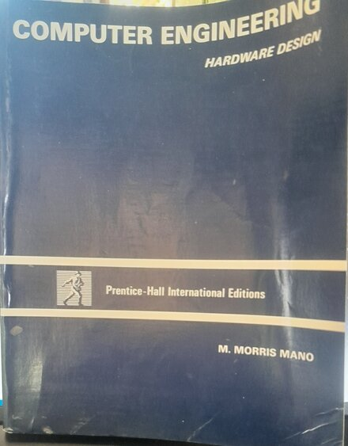
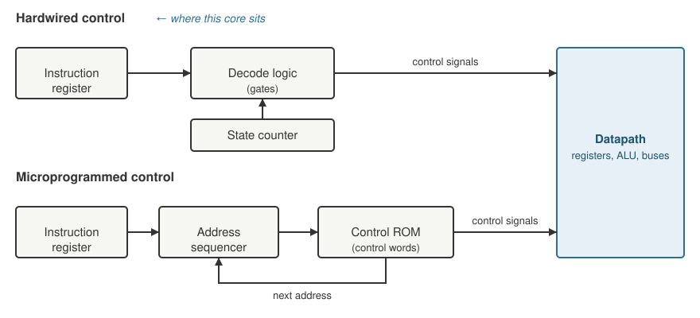

+++
date = '2026-10-18T14:00:00+11:00'
draft = false
title = 'RISC-V soft core 0: Firmware'
author = 'Dean Sellers'
tags = [
    "riscv-cpu",
    "riscv",
    "fpga",
    "firmware",
    "embedded",
    "hardware"
]
+++

# Firmware, "You keep using that word. I do not think it means what you think it means"

*Part 0 of a series on building a RISC-V processor from scratch on an FPGA. Next: [a CPU you can watch]().*

My job title has the word *firmware* in it, and so do most of the job ads I see that look like mine. If you read those ads, what they want is C and C++ on a microcontroller or a small microprocessor: bring up the board, write the drivers, talk to the peripherals, make it not fall over in the field. Additionally some RTOS, embedded Linux and build system expertise.

I have spent a good part of my career doing exactly that and I like it. What I notice though is that nobody asks about the hardware *under* the microcontroller. Off the shelf silicon is done, it is cheap, it is flexible and it is very well documented, so in most cases there is no reason to build your own. The wiring and the logic design are somebody else's problem, and that somebody is very good at it.

I was trained in hardware and logic, and a long time ago I did spend time with gates and flip-flops, so this has bugged me for a while. We call ourselves firmware engineers and we have drifted a fair way from where the word came from. A recent project at work turned out to be one of those cases where custom logic beats off the shelf silicon, which sent me back to the bookcase. So out came Mano and I read the first chapters again, then came an HDL, then RISC-V ... how hard can it be to design a processor?

## What the word used to mean

*My copy of Mano's book, a bit worse for wear.*

On my shelf is a copy of M. Morris Mano's *Computer Engineering: Hardware Design*, the Prentice-Hall International Edition, 1988. It is well used and a bit battered. Chapter 8 is about control logic, and in section 8-5 it describes the microprogram method of building a control unit. Each machine instruction runs a little program of *microinstructions* held in a ROM inside the control unit, and writing those is described as being *very similar to writing assembly language programs for a computer*. Then comes the line I keep coming back to, that the microprogram method

> is sometimes referred to as *firmware* to distinguish it from the purely hardware method (which is also called hardwired control) and the software concept which constitutes a purely programming method.

So originally *firmware* was something that lived *between* hardware and software. A program, but one inside the control unit, deciding which registers load and which bus is selected on each clock. It was the thing that turned a pile of gates into a computer that understood instructions. Somewhere along the line the word moved up a layer and now means *software that is hard to update*, which is a perfectly good definition and also a bit of a shame.

The book describes the two ways of building that control unit side by side. The *hardwired* method is a state machine and some decoding logic. The *microprogrammed* method is a ROM full of control words and an address sequencer. Same machine, two ways to make it go.

*Two ways to build a control unit. Same datapath, same control signals. The RISC-V core in this series is the top one.*

Why would anyone choose the ROM? In a CISC machine it makes good sense. CISC means *complex instruction set computer*, and complex is the word to hold on to: instructions are many and elaborate, and a single one can take a dozen cycles, so a little program per instruction is a tidy way to keep it all straight. A ROM can be faster than main memory, so doing the heavy lifting in microcode pays for itself. RISC turns that around. A small set of simple, fixed format instructions needs only a small decoder, plain gates and no stored program, and the chip area you save goes into registers and cache. The control program didn't vanish so much as get *baked in*, which is a big part of why the word *firmware* ended up a layer higher.

It isn't a clean split. Modern x86 is a CISC instruction set with hardwired logic for the common cases and a microcode ROM for the awkward ones, and that microcode gets patched by updates, so firmware in Mano's sense is still out there. This RISC-V core has a tiny microprogram of its own hiding in plain sight: a sequencer that steps through fetch, execute, memory and writeback, with the decoder acting as the ROM. It is just built from logic instead of a memory.

## The project I didn't build

I should be honest here, I never built the Mano machine, I never even started. The book takes you from flip-flops to registers to a register transfer language to a whole basic computer, and it is a lovely progression but not one I really wanted to sign up for.

Mano's computer has its own instruction set, and an instruction set with no software is a very expensive set of blinking lights. To do anything with it I would need an assembler, and then something to write programs in that is nicer than an assembler, so a compiler, and *that* is a rabbit hole with no bottom. I had neither the time nor the desire to go down it as well, so the book went back on the shelf.

## What changed

[RISC-V][riscv] is the answer to the rabbit hole. It is an open instruction set that already has a compiler, an assembler, a linker, a debugger and a specification that is precise enough to *test against*. I don't have to invent any of that. I just have to build something that obeys the spec and then the world's tools are mine.

The other thing that has changed is 1988. When this book was printed, building its computer meant hand wiring gates on breadboards, a lot of them, and a lot of chasing a wire that was *nearly* in the right hole. A working microprocessor from first principles was a serious project and not one you did on the weekend, although some have and more power to them. Now I can buy an FPGA board for the price of a couple of dinners, write the processor in a hardware description language, run it through a free synthesis tool and have it running in minutes. I can simulate it, put it in a testbench, watch every signal and fix a mistake without touching a wire. The *principles* in the book (registers, a control unit, a sequencer, microoperations) all still apply. The soldering iron is optional.

I think that is the interesting part. It was not possible to come back to the spirit of that book, and actually get a working microprocessor out of it, when we were all wiring up chips. It is now, and as a bonus I get a fairly capable little dev board with any combination of peripherals I want, until I run out of LUTs.

## What I'm building

The board is an [Alchitry Cu][cu], a Lattice iCE40 HX8K FPGA with an [Io board][io] on top for the switches, LEDs and seven segment display. The processor is a RISC-V core, RV32E, so 32 bit with 16 registers, written in [Lucid][lucid] which is the language Alchitry's own tools use. Lucid compiles to Verilog and some might argue I should have used that instead, but Lucid is close enough and I started there, so I stayed there. It is built for 25 MHz and the build fills about two thirds of the chip. I should be clear that so far it has only run in simulation, never on the board itself. The board is on backorder so the first run on the real hardware is still to come, and that is the real test.

On the Mano scale it sits on the *hardwired* side, a decoder plus a sequencer. It is a multicycle design with no pipeline, so each instruction goes fetch, execute and, for loads and stores, a memory step or two. I picked that on purpose. I want to be able to watch it think, one clock at a time, and see what it is doing.

By the time we are done it will have boot code, a UART, a timer, interrupts and traps, and a front panel on the DIP switches and LEDs. It is going to find the edges of itself in a few interesting ways, and the wrong turns along the way are, I think, the better story, so I am keeping a lab notebook as I go and you will get the mistakes along with the code.

I should say that until recently the thing that was *missing* was real software. In simulation it had run assembly I wrote for the tests, and a Larson scanner (the LEDs sweeping back and forth) that I am inordinately fond of. This again shows my vintage, Knight Rider and Battlestar Galactica! Now it has run C as well, still in simulation: a gcc-compiled program prints *Hello from C!* over the UART, and it is an entry in the board's boot menu. That is the bit that the old Mano machine never would have given me.

The source is on GitHub as [RISCitry](https://github.com/d-o/RISCitry). It is the machine as it stands now, so it is well ahead of where this series starts.

## What's next

The series comes in two threads. The main one is the machine itself, from the first state machine and a blinking light up to interrupts and sleeping. The second is the *tools*, because I ended up writing my own front end for Verilator after finding out that the simulator that comes with the IDE sometimes tells fibs, and it is a better way to *see* what is going on. That thread starts with [the simulator I use]().

First up in the machine thread, [the CPU you can watch](), and a double beat in my Larson scanner that I put down to a pipeline, in a processor that has no pipeline ...

## References

- RISC-V ISA manual (v20260120): <https://docs.riscv.org/reference/isa/v20260120/index.html>
- M. Morris Mano, *Computer Engineering: Hardware Design* (Prentice Hall, 1988)
- Alchitry Cu: <https://alchitry.com/boards/cu/>
- Alchitry Io: <https://alchitry.com/boards/io/>
- Lucid reference: <https://alchitry.com/tutorials/references/lucid-reference/>
- RISCitry, the source: <https://github.com/d-o/RISCitry>

[riscv]: https://docs.riscv.org/reference/isa/v20260120/index.html
[cu]: https://alchitry.com/boards/cu/
[io]: https://alchitry.com/boards/io/
[lucid]: https://alchitry.com/tutorials/references/lucid-reference/
