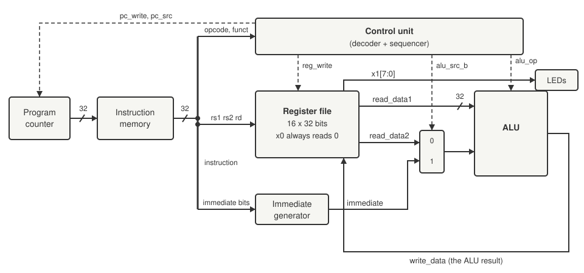
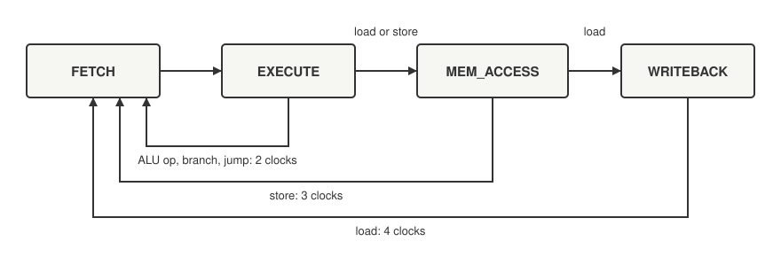

+++
date = '2026-10-18T16:00:00+11:00'
draft = false
title = 'RISC-V soft core 1: A CPU you can watch'
description = "Building a tiny CPU from a program counter, memory, register file, ALU and control unit, until LEDs sweep along a row, and a double beat that was not a pipeline."
author = 'Dean Sellers'
tags = [
    "riscv-cpu",
    "riscv",
    "fpga",
    "state-machine",
    "embedded",
    "hardware"
]
+++

# A CPU you can watch, and a double beat that was not a pipeline

*Part 1 of the RISC-V soft core series. Previously: [Firmware]().*

Last time I said I wanted a processor I could watch think. This time we get one, from a blank page to a light that sweeps back and forth along a row of LEDs. The code below is from the first commit of the project. It has grown a lot since, but the shape is the same.

A CPU is smaller than people expect. There are really only five things:

1. a **program counter**, a register that holds the address of the next instruction,
2. a **memory** that turns an address into an instruction,
3. a **register file**, the CPU's scratch space,
4. an **ALU**, which adds, shifts and compares,
5. a **control unit** that decides what happens when.

Everything else is wiring. I am using [Lucid][lucid], the language Alchitry's tools come with. If you can read C you can read most of it, with the odd surprise: `dff` is a flip flop (a bit of memory), and `always` describes logic that is evaluated all the time, not a sequence of steps.

## The heart: the program counter

The program counter is the part that beats. It is a 32 bit register, and on every beat it either steps forward by four bytes (an instruction is four bytes long) or jumps somewhere else.

```text
module program_counter (
    input clk, input rst,
    input pc_write,             // 1 = update the PC, 0 = hold it
    input pc_src[2],            // 00 = PC + 4, 01 = jump target
    input target_address[32],
    output pc[32]
  ) {

  dff pc_reg[32](#INIT(0), .clk(clk), .rst(rst))
  sig next_pc[32]

  always {
    pc = pc_reg.q

    case (pc_src) {
      2b00:    next_pc = pc_reg.q + 4
      2b01:    next_pc = target_address
      default: next_pc = pc_reg.q + 4
    }

    if (pc_write) pc_reg.d = next_pc; else pc_reg.d = pc_reg.q;
  }
}
```

A `dff` has two sides: `.q` is what it holds now and `.d` is what it will hold after the next clock edge. The `always` block only describes `.d`. That is the whole trick of sequential logic: everything happens on the clock edge, all at once. The clock is what gives a design a time of its own, and a lot of what follows is about what happens when that time meets someone else's. The version above is trimmed a little (the original also handled the `jalr` jump), but that is the beating heart.

Lucid makes you say which side of the flip flop you mean. In Verilog a register is a single name and the `<=` assignment quietly does the same job.

## The first program

The program is the memory's contents. In that first commit the memory was a big `case` statement, an address on one side and a 32 bit instruction on the other:

```text
14h0000: instruction = 32h00100093; // 0x00: addi x1, x0, 1   (start bit at LED 0)
14h0001: instruction = 32h00109093; // 0x04: slli x1, x1, 1   (move to LED 1)
14h0002: instruction = 32h00109093; // 0x08: slli x1, x1, 1   (move to LED 2)
```

Those hex numbers are real [RISC-V][riscv]. `0x00109093` is `slli x1, x1, 1`, shift register `x1` left by one, and here is how it unpacks:

| immediate | rs1 | funct3 | rd | opcode |
|---|---|---|---|---|
| `000000000001` | `00001` | `001` | `00001` | `0010011` |
| 1 | x1 | shift left | x1 | immediate arithmetic |

Read right to left: the opcode says "arithmetic with an immediate", `rd` is where the answer goes, `funct3` picks which operation, `rs1` is the source and the immediate is the 1. `srli`, shift right, is the same word with `funct3` changed from `001` to `101`, which makes `0x0010D093`.

I did not encode those by hand, and neither should you. A short Python script assembles instructions and decodes them back, and I checked every word against it before putting it in. The jump words in particular are a mess of scrambled bits.

## Reading and doing

Next the register file. RV32E has sixteen registers of 32 bits each, and register 0 is wired to read as zero whatever you write to it:

```text
dff registers[16][32](.clk(clk), .rst(rst))

if (rs1_idx == 4b0000) read_data1 = 32h00000000; else read_data1 = registers.q[rs1_idx];

registers.d = registers.q
if (reg_write && (rd_idx != 4b0000)) registers.d[rd_idx] = write_data
```

The ALU is a big `case` that picks an operation from four bits of the instruction:

```text
case (alu_op) {
  4b0000:  sig_result = a + b
  4b0001:  sig_result = a << b[4:0]     // slli, sll
  4b0101:  sig_result = a >> b[4:0]     // srli, srl
  4b0110:  sig_result = a | b
  default: sig_result = 32h0
}
```

And the top level wires it all together. This is the part that is a circuit diagram written as text:

```text
alu_unit.a = reg_file.read_data1;
if (control.alu_src_b) alu_unit.b = immediate_generator.immediate;
else                   alu_unit.b = reg_file.read_data2;

reg_file.write_data = alu_unit.result;
reg_file.reg_write  = control.reg_write;

led = reg_file.debug_x1[7:0];        // watch register x1 on the LEDs
```

That last line is the whole display. The eight LEDs are wired straight to the bottom eight bits of register `x1`. The scanner is a program that moves a single one bit through `x1`.



*The first datapath, the wiring above drawn as a diagram. Solid lines carry data and dashed lines are control signals from the control unit. The clock and reset go to every register and are not drawn, and neither is the jump target (the program counter plus the immediate).*

## One heartbeat

Follow `slli x1, x1, 1` through. The program counter holds `0x04`. The memory hands back `0x00109093`. The decoder splits that into its fields and the register file reads `x1`. The immediate generator pulls out the 1. The ALU shifts `x1` left by it, the result goes back into `x1`, the program counter adds four, and the LEDs move along one place.

That is an instruction. Seven of them in a row take the light from one end to the other.

## The double beat

The first version of the scanner went left seven times, right six times, and then jumped back to the start with `jal x0, back`. It nearly worked. When the light reached the end it hung around for an extra step before turning back. Every position lasted one step and the end of the scan lasted two. A scanner that stutters at one end looks broken, and it was.

The AI assistant I was working with had an answer ready, and it was confident. A *pipeline branch penalty*, it said. The jump flushes the pipeline and the core wastes a slot, so the fix is a *delay slot*, an extra shift placed after the jump that runs while the jump is being fetched. It even wrote it into the source:

```text
// THE DELAY SLOT INSTRUCTION: This fires DURING the jump's fetch latency cycle.
14h000F: instruction = 32h0010D093; // 0x3C: srli x1, x1, 1
```

It sounds plausible. It is also wrong, because this core has **no pipeline**. It does one instruction completely before it starts the next, so there is no penalty to pay and no delay slot to fill. That `srli` after the jump is never executed. A bit of the old story is still sitting in the first commit, in a register called `if_id_reg` and a comment that says "Pipeline Wire Routing", and none of it is true.

The real cause was much more boring, and I only found it by walking through the clocks one at a time. Every instruction takes two clocks here, one to fetch and one to execute. A `jal x0` is an instruction like any other, so it gets its own two clocks, and because it writes to `x0` (which reads as zero whatever you do to it) it does not change `x1`. For those two clocks the LEDs show exactly what they showed before. The jump was not slowing the scanner down. The jump *was* a step, and it was a step where the light did not move.

The fix was to make the jump do some of the work. A `jal` also saves the address of the instruction after it into a register, so I changed it to `jal x1, ...` and placed it at address `0x7C`. It saves `0x7C + 4 = 0x80` in `x1`, and `0x80` is the bit for LED 7. The jump is now a display step like any other:

```text
LARSON = [
    "boot:",
    ("jal", 0, "turn"),
    (".org", 0x48),
    "right:",
    *[("srli", 1, 1, 1)] * 7,
    "left:",
    *[("slli", 1, 1, 1)] * 6,
    "turn:",
    ("jal", 1, "right"),    # links pc + 4 = 0x80: LED 7, so the jump is a display step
]
```

That change needed a feature I had not built yet. My `jal` did not write the link register at all, so I had to add that first. The program above is how it looks today, written for a small assembler I made for the tests, and it turns out the same instruction words as the hand written version would.

The wrong turn is the part I like. The textbook explanation sounded right, and if I could not look at the real machine I would have kept the delay slot and never questioned it.

## Four states

So how does the control unit decide what to do? It is a small sequencer with four states.



*The sequencer. Every instruction starts in FETCH and goes to EXECUTE. Most finish there; stores take a third clock and loads a fourth.*

FETCH reads the instruction, EXECUTE does what it says. A store needs another clock to write to memory (MEM_ACCESS), and a load needs a clock after that (WRITEBACK) because the memory takes a cycle to answer. One instruction completes before the next starts. No pipeline, no overlap, and 2, 3 or 4 clocks per instruction depending on the kind.

That is slow, and I picked it on purpose. It makes the machine easy to reason about, and you can follow it with your finger on the page.

The sequencer only sequences. A separate block, the decoder, looks at the instruction and produces all the control signals, and the sequencer decides *when* they take effect. If you remember the diagram from part 0, this is the hardwired control unit: gates for the decoder, a state register for the sequencer, no ROM.

## Watching it think

The whole point of the 2, 3, 4 clock design is that you can see it. The [Io board][io] that sits on top of the [Alchitry Cu][cu] has three banks of eight DIP switches and eight LEDs, four seven segment digits and a handful of buttons, and I have wired most of it up as a front panel in the style of the old machines:

- one switch stops the machine, and the centre button then steps it **one instruction**,
- another switch changes a step to a single *clock*, so you can watch FETCH, EXECUTE and the rest go past,
- the four Cu LEDs show the state, one light per state,
- the seven segment display shows the program counter in hex,
- the LEDs on the [Io board][io] show the register I pick on another bank of switches, `x1` for the scanner.

At full speed the clock is 25 MHz and the scanner is a blur, so the design slows the CPU clock for the board, to about 24 Hz. Two clocks per instruction gives about twelve steps a second, a sweep in a bit over a second, which is a speed the eye likes.



That is a clip from a simulator I built around the design, drawing Alchitry's own board. It gets its own post, [The simulator I use](), which says what is mine and what is not. The state lights on the Cu cycle through FETCH and EXECUTE while the [Io][io] LEDs walk along.

## What I learned

Counting clocks by hand found a bug that a confident explanation had talked me out of. If a story about your hardware includes a part your hardware does not have, go and read the state machine.

Next time, [how I make sure this thing does what it says](), and how a testbench that cannot fail is worse than none.

## References

- RISC-V ISA manual (v20260120): <https://docs.riscv.org/reference/isa/v20260120/index.html>
- Alchitry Cu: <https://alchitry.com/boards/cu/>
- Alchitry Io: <https://alchitry.com/boards/io/>
- Lucid reference: <https://alchitry.com/tutorials/references/lucid-reference/>

[riscv]: https://docs.riscv.org/reference/isa/v20260120/index.html
[cu]: https://alchitry.com/boards/cu/
[io]: https://alchitry.com/boards/io/
[lucid]: https://alchitry.com/tutorials/references/lucid-reference/
