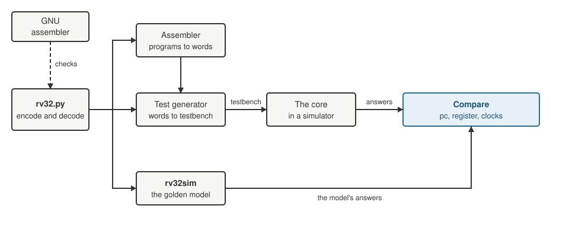

+++
date = '2026-10-18T18:00:00+11:00'
draft = false
title = 'RISC-V soft core 2: Tests that can fail'
author = 'Dean Sellers'
tags = [
    "riscv-cpu",
    "riscv",
    "fpga",
    "testing",
    "verification",
    "hardware"
]
+++

# Tests that can fail, and a RAM that was never there

*Part 2 of the RISC-V soft core series. Previously: [A CPU you can watch]().*

A light that sweeps along a row of LEDs is a nice demo and a poor proof. It tells me that a handful of instructions work in one order. It says nothing about all the others, or about the edges of the ones I used. If this core is going to run real code I need to be able to trust it, and I need to know *how much* I can trust it.

This post is about that, and the main idea fits in a sentence: **a test you have never seen fail has told you very little.**

## One place for the bits

Every instruction is a 32 bit word with its fields scrambled into odd places, and the branch and jump immediates are the worst of it. I might have a grey beard, but I do not hand encode them. Why would I? I needed tools to do this at all, and a machine maker builds jigs before the machine. The jig here is the obvious single source of truth, one small Python file, `rv32.py`, that knows how to build every instruction format and how to take one apart again. Everything else in the project, the assembler, the test generators and the golden model, imports it. If the encodings are wrong they are wrong in one place.

That also makes it a single point of failure, so it checks itself. The self test does not just round trip its own output, because a bug that is symmetric would survive that. It compares against a handful of words I checked against the GNU RISC-V assembler, so the check comes from outside my own code. The first four are enough to show what it catches:

| Word | Instruction | What it pins down |
|---|---|---|
| `00000013` | `nop`, which is `addi x0, x0, 0` | the opcode and `funct3` of an immediate operation, with every other field zero |
| `0000006F` | `j .`, which is `jal x0, 0` | the jump opcode and an offset of zero |
| `00B50533` | `add a0, a0, a1` | the register fields: `a0` is x10 and `a1` is x11, so `rs2` is 11, `rs1` and `rd` are 10 |
| `40B50533` | `sub a0, a0, a1` | the same word with only bit 30 set, the one bit that makes it a subtract |

The real list has 22 words, including the Larson scanner's.

## Testbenches that write themselves

The immediate generator is a good place to start, because it is pure logic with a clear right answer. Each RISC-V instruction format puts its immediate in a different arrangement, and the unit has to put it back together and sign extend it.

I did not write that testbench. A script generates it, with 90 checks. Each immediate is encoded twice, once with every *other* field in the word set to all ones and once with them set to zero. If a neighbouring bit leaks into the result, the all ones version shows it. The immediates include the extremes, alternating bit patterns and the offsets the Larson scanner uses.

It passed first time, which is exactly when to be suspicious.

## Break it on purpose

So I broke the design. I made a scratch copy of the module and dropped bit 11 from the branch immediate. Then I ran the testbench:

```text
inst=ffffffe3 got=fffff7fe want=fffffffe
```

The `b_type` group failed on the first word that uses that bit, and every other group still passed. That is the result I wanted, a failure in the right place, with enough detail to see what went wrong.

This became a rule for the project: **every new testbench gets a deliberate bug.** When I added the decoder I tried three mutations. One made `addi x15,x15,-1` decode as a subtract, one removed the check for the registers RV32E does not have, and one removed the check that rejects `mul`, which this core does not have. Each was caught by the right test, with a diff.

It is a cheap habit and it finds real holes, especially when you just have to ask.

## A second opinion at every clock

Unit tests prove the parts. For the whole core I wanted something to check it against, so I wrote a second model of the machine: `rv32sim`, a Python instruction set simulator. It is deliberately dumb and takes the specification at its word, one instruction at a time.

Then the generated testbenches run a real program on the design in a simulator and compare it with the model after *every instruction*: the program counter, the register that was written, and the number of clocks it took. That last one matters. The core is a state machine with a fixed rhythm, two clocks for most things, three for a store, four for a load, so a test that checks the answer and ignores the timing would pass a core that quietly added a cycle. At the end of each program every one of the sixteen registers is compared as well.



*How a program is checked. Everything that knows an encoding gets it from `rv32.py`, which is itself checked against the GNU assembler. The core and the model are run separately and only meet at the compare.*

The programs themselves are small and aimed at edges. One runs every arithmetic operation with signed against unsigned values. One takes all six branch conditions both ways. One calls and returns, and uses `jalr` with a low bit set. One writes to memory, including the top word of the RAM.

I ran those programs on the core and three of the four passed straight away. The fourth, the memory test, got this back from its first load:

```text
xxxxxxxx
```

## The RAM that was never there

An `x` is a value the simulator does not know. A load that returns it means the data never arrived. My first thought was a bug in the core. It was not.

The simulator that comes with Alchitry Labs does not simulate Verilog components, and the block RAM I was using is one. A testbench pointed straight at it showed `x` on the output, even right after a write. Which meant that **no load had ever worked in simulation**, not in my testbenches and not in the IDE's board view. The real tools had no complaint about the Verilog, they synthesise it without any trouble. The simulator just could not run it, so I had simply never tested memory, and nothing had told me.

My first fix was the obvious one, and it was a mistake. I rewrote the RAM in Lucid so that it simulated. The tests passed. Then I built it for the FPGA and the design went to 4,933 logic cells, with no block RAM at all, because a Lucid array becomes flip flops. The memory had turned into thousands of them. The clock speed dropped from about 60 MHz to 45.

The fix that stuck was to keep both. The RAM module holds the Verilog block RAM for the build and a Lucid model for simulation, fed identical inputs, and picks the output depending on where it is running. In a real build the model's output is unused, so the tools throw it away and the area goes straight back down. In the testbenches, and in the IDE's board view, memory works.

I do not want to leave this as a neat bug story, because the point is how it was found. The memory test failed *because* it compared against a golden model. A light on a board would have kept sweeping, and I would have carried on thinking my memory worked.

## A test that passed for the wrong reason

Mutation checks do not only test the design. They test the tests.

When I added the UART, a store to the data register should only send a byte when the *lowest* byte lane is written. I checked that a byte store to lane 1 does not send anything. Then I broke the decoder so that *any* lane would send, and the test still passed.

It was the test that was wrong. The lane 1 store came straight after another byte was sent, while the UART was still busy, so even the broken design dropped it. The test could not tell the difference. I changed the program to wait until the UART is idle before the store, ran the mutation again, and this time an `X` turned up as the second byte on the wire. Now it could fail.

## Edges on purpose

Once the machinery was in place I wrote programs for the corners, which is where cores break.

- **Strings.** A program walks a string in memory with `lbu` and prints it.
- **Tables.** Words, halfwords and bytes read back from tables, and a jump through a table of addresses.
- **Self modifying code.** A store that changes an instruction a few places ahead. This one behaves oddly on purpose, and I will come back to why next time.
- **Illegal instructions.** Thirteen of them, including 64 bit loads and stores that RV32 does not have, a register that RV32E does not have, a CSR that does not exist, and a branch with a bad `funct3`.

That last list is the one I like. A core that runs good code correctly is the easy part. What it does with garbage is where the surprises are.

## What I learned

Three things I now do without thinking:

1. Put the knowledge in one place, and make that place check itself against something outside the project.
2. Compare against a model after every step, and include the timing.
3. Break the design on purpose, in a scratch copy, and watch the right test fail. If nothing fails, the test is the bug.

A passing test suite is a statement about the tests, not about the design.

Next time, [the memory I had been simulating, and why the first design was Harvard by accident](). If you want to see how I watch all this run, the parallel simulator thread starts with [The simulator I use]().
