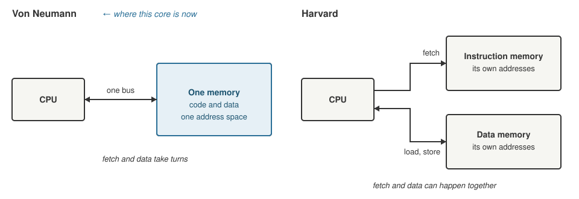

+++
date = '2026-10-18T19:00:00+11:00'
draft = true
title = 'RISC-V soft core 3: Harvard by accident, von Neumann by choice'
author = 'Dean Sellers'
tags = [
    "riscv-cpu",
    "riscv",
    "fpga",
    "memory",
    "architecture",
    "hardware"
]
+++

# Harvard by accident, von Neumann by choice, and a store that runs the old word once

*Part 3 of the RISC-V soft core series. Previously: [Tests that can fail]().*

I was reading the memory map when I asked a question that sounds too simple to matter: *so the map contains no ROM?*

It did not. The map described the data side of the core, a block of RAM and a UART. The program lived somewhere else entirely, in a ROM on its own bus, addressed by the program counter. Loads and stores could not reach it. Instruction address 0 was a different place from data address 0.

That has a name, a **Harvard** architecture, and I had not chosen it. It happened because of how I wrote the first ROM, a big `case` statement in [part 1](), an address on one side and an instruction on the other. The architecture fell out of the first thing I typed.

## One memory or two



*Von Neumann on the left, Harvard on the right. The core is moving from the right hand picture to the left.*

- **Von Neumann.** Instructions are data. One memory, one address space, and fetches and data accesses take turns on the same path. It is the stored program computer of 1945, and it is what Mano's Basic Computer is: one memory, one bus.
- **Harvard.** Two memories with two buses, named after the Harvard Mark I (the program was on punched tape and the data in relays). A fetch and a data access can happen at the same time, and the two memories can be different widths. The price is that code is not data.

And then there is the thing nearly every modern processor actually does, **modified Harvard**: separate paths, but one address space, so you can still read code as data.

## What pure Harvard was costing me

More than I expected, once I wrote it down.

- No strings and no tables in memory. The first thing the core printed had to be built up from immediate values, because there was nowhere to keep the characters.
- No `.rodata` and no `.data`. A C program expects constants and initialised variables to be in memory somewhere. Mine had nowhere to put them.
- No loading a program at run time, so no bootloader, and no front panel deposit.
- And RISC-V's own tools assume a single address space. The linker scripts, the sections and `FENCE.I` all take it for granted.

I had set out to run real code, and the machine I had built could not hold a string.

## The core gains nothing from Harvard

Here is the part I like. The usual reason for Harvard is speed: fetch the next instruction while the current one is touching data. This core never does that. It is a multicycle machine, and FETCH uses the memory in one clock and MEM_ACCESS uses it in another. A single shared memory is exactly as fast.

A pipeline would care. It fetches the next instruction while the current one loads or stores, so it would want two paths into one memory, which is modified Harvard, or it would stall on every memory instruction. That is a later chapter.

So the requirement that matters is one *software visible* address space, where a code address and a data address mean the same thing. How many physical paths there are underneath is an implementation detail, and it can change later without software noticing. The decision was one shared port now, and two paths into the same map if a pipeline ever arrives.

## A detour through an ESP32

I remembered that the ESP32 has a Harvard flavour of its own, and the comparison helped. As I remember it, some if not all the ESP32 series maps its internal memory twice, as IRAM on the instruction side and DRAM on the data side, at different addresses, and its software has `IRAM_ATTR` and `DRAM_ATTR` to say which one you mean.

| | Paths | Address spaces | Code readable as data? |
|---|---|---|---|
| Pure Harvard (this core, before) | 2 | 2, unrelated | no |
| ESP32 style | 2 | one map, the same memory at two addresses | yes, at the other address |
| Cortex M, textbook modified Harvard | 2 | 1, the same address | yes, at the same address |
| Von Neumann (this core, now) | 1 | 1 | yes, at the same address |

The lesson I took from it is that a memory map follows from how the buses are wired, not from what is nicest for software. Software pays for it, with attributes and alignment rules and two addresses for the same byte. I get to trade the other way. My core gains nothing from two paths, so the software gets the clean map.

## The problem with a real memory

A ROM written as a `case` statement answers in the same clock you ask. A block RAM on the FPGA does not: it takes the address on one clock edge and the data appears after it. So the fetch address has to be presented a clock early.

I considered three ways to do it:

- **An extra fetch clock.** Trivial, but every instruction gets one clock slower, so a third to a half more time.
- **Decode straight from the RAM output.** Fast, but it puts a multiplexer in front of the decoder.
- **Fetch in the previous instruction's last clock.** This is the one I took.

In the last clock of an instruction, the next address is already known. The branch has been decided and the jump target has been added up. So that clock can hand the next address to the RAM, and the next instruction is waiting when FETCH begins. The clock counts stay as they were:

| Instruction | Clocks | What the last clock does |
|---|---|---|
| ALU, jump, branch | FETCH, EXECUTE | asks for the next instruction |
| Store | FETCH, EXECUTE, MEM_ACCESS | writes the data and asks for the next instruction, on the same edge |
| Load | FETCH, EXECUTE, MEM_ACCESS, WRITEBACK | MEM_ACCESS asks for the data; WRITEBACK receives it and asks for the next instruction |

This is not speculation, because the address is final by then. There is still no branch penalty and nothing to flush.

## The store that runs the old word once

Look at the store row again. In its last clock, the core writes the data and asks for the next instruction on the *same* edge. What happens if the store writes to the very word that is about to be fetched?

The RAM reads before it writes, and it is the same rule as `.q` and `.d` from part 1. On a clock edge everything samples what it held *before* the edge. The read side takes a copy of the word that is in the RAM now, `.q`. The write side sets what the RAM will hold afterwards, `.d`. They happen on the same edge, so the read gets the old word and the new one only becomes visible after the edge. The next instruction runs stale, and the one after that is the new one.

That sounds like a bug, and it is not. RISC-V only promises that an instruction fetch will see an earlier store after a `FENCE.I`, which is the [Zifencei][zifencei] extension. The spec says a `FENCE.I` makes a later fetch see any earlier data stores that are already visible to the same hart, and without one there is no promise at all. This core does not implement Zifencei yet, so a `FENCE.I` traps as an illegal instruction. If it did, it could be a NOP, because the instruction after it is fetched in its own last clock, after the store has landed.

Verilog spells the same rule with the non blocking assignment, `<=`. This is the heart of the RAM, trimmed to one of its four byte lanes:

```text
always @(posedge clk) if (ce) begin
  rdata[7:0] <= lane0[raddr];                 // the read, evaluated first
  if (be[0]) lane0[waddr] <= wdata[7:0];      // the write, lands after the edge
end
```

Every right hand side is evaluated with the values from before the edge, and only then do the left hand sides change, so if `raddr` and `waddr` are the same the read gets the old word. With a blocking `=` the result would depend on the order of the lines, and with two modules it would depend on which one the simulator ran first. That is the classic Verilog race, and a simulator that gets it wrong is the subject of [a later post in the simulator thread]().

This is a promise the core builds on, and not a footnote. By design, a store's last clock writes *and* fetches on the same edge, so the RAM has to say what a collision returns. On the FPGA's block RAM, reading and writing one address on the same edge is undefined, so the build adds extra logic to deliver read before write, about 80 flip flops and 50 LUTs. I specify the behaviour, and the tools have to supply it. Everything after it, the prefetch and the stale word, hangs on it.

I wrote a test program for it, `SELFMOD`. A store two words ahead takes effect. A store over the very next word does not, once, and the final register ends up as 3 with the prefetch and 4 without. The Python model reproduces that exactly, so the test compares the quirk and not just the happy path.

## Two things that went wrong

The change touched everything at once: the RAM became 8 KB for code and data, both bus ports decode by address, the model in Python got one memory preloaded with the program. After the first run **every test executed its first instructions as NOPs.**

I had given the "the RAM answered" select signal the CPU's reset, so on reset's last edge the first instruction was read from the RAM and then thrown away. The earlier Harvard version never showed it. The fix was to take the reset off it, like the RAM's own read register.

The second one turned up the same day. All 36 testbenches passed, and so did the cross check in Yosys. Then in the IDE's board view, stepping the core, the program counter went:

```text
0000  007C  00F8  0174  01F0  026C
```

Larson's first instruction is a jump of `+0x7C`, so the CPU was executing word 0 over and over.

The testbenches switch the RAM's simulation model on with a parameter. The IDE's board view does not, and relies on a built in test for "am I simulating" instead, and that test was in a place where the two disagreed. No testbench could see it. The lesson is that opening the board view after every structural change is part of the test. The details belong in the simulator thread.

## What fell out of it

Once code and data share a map, a lot arrives for free:

- strings and tables in memory, and a program that walks a string and prints it,
- C with a normal linker script, which is what the later posts need,
- a program image that is just memory contents, so the build no longer changes size with the program,
- room for deposit and examine on the front panel,
- the same organisation as Mano's machine, which closes a small circle.

Next time, [the part where the core starts talking to the world](): memory mapped I/O, a UART, and a boot menu.

## References

- RISC-V ISA manual (v20260120): <https://docs.riscv.org/reference/isa/v20260120/index.html>
- Zifencei, instruction fetch fence: <https://docs.riscv.org/reference/isa/v20260120/unpriv/zifencei.html>

[zifencei]: https://docs.riscv.org/reference/isa/v20260120/unpriv/zifencei.html
