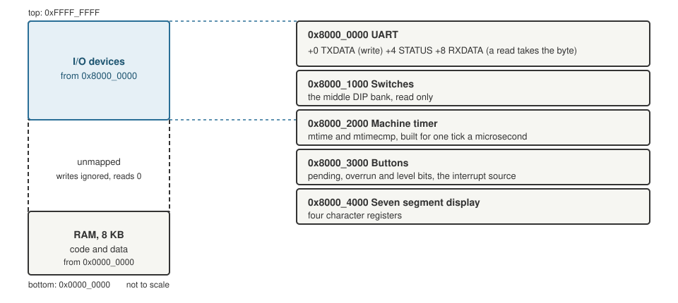

+++
date = '2026-10-19T00:05:00+11:00'
draft = false
title = 'RISC-V soft core 4: Talking to the world'
description = "RISC-V has no I/O instructions. Memory mapped I/O on the soft core: the address map, a UART, and a boot menu driven by loads and stores."
author = 'Dean Sellers'
tags = [
    "riscv-cpu",
    "riscv",
    "fpga",
    "uart",
    "memory-mapped-io",
    "hardware"
]
+++

# Talking to the world: loads, stores and a boot menu

*Part 4 of the RISC-V soft core series. Previously: [Harvard by accident, von Neumann by choice]().*

So far the core can add, branch, load, store and light some LEDs. It cannot tell me anything. For that it needs a way to talk, and RISC-V gives you a surprisingly short answer about how: it has **no input and output instructions at all**. There is no `IN` and no `OUT`, as on an x86. The way you reach a device is the way you reach memory, with a load or a store to a particular address.

That is called memory mapped I/O, and the previous post is what made it easy. Once code and data share one address space, a device is just another range of addresses.

## The map

*The whole 32 bit address space, not to scale. Eight kilobytes of RAM at the bottom, the devices at the top, and nothing in between.*

The map is defined once, in a small Python file, and everything else is generated from it: the Lucid constants for the hardware, the model, and the test programs. If a device moves, one line changes.

Each device decodes its own addresses completely. A write to an unmapped address is ignored and a read from one returns 0. A fetch from the I/O range reads 0, which decodes as an illegal instruction, so a program that jumps into the UART by mistake traps instead of running garbage.

## The UART

A UART sends bytes down a wire one bit at a time, at an agreed speed. I wanted one so the core could print, and a terminal on the other end is the best debugger there is. It has three registers:

| Offset | Name | What it does |
|---|---|---|
| +0 | TXDATA | a store here sends the byte in the lowest lane |
| +4 | STATUS | bit 0: a transmit is in progress; bit 1: a received byte is waiting; bit 2: a received byte was lost |
| +8 | RXDATA | a load gives the received byte, and *consumes it* |

To print a character a program waits until STATUS says the transmitter is idle, then stores to TXDATA. In assembly it is a three instruction loop: load the status, branch back if busy, store the byte.

### The clock problem

The first design ran into something I had not expected, and it is the thing I like best about this part.

A UART needs a *steady* clock. It has to hold each bit for exactly the same time. The CPU's clock, in this design, is none of those things. It can be slowed down so I can watch it, stopped, and single stepped. So the part that times the bits has to run on a different clock from the CPU, and the byte has to get from one to the other.

Anything that crosses between two clocks has to be done carefully, because a signal can change right as the other side is looking at it. The solution is a **toggle handshake**:

- The CPU side saves the byte and flips a `req` flag.
- The transmit side sees `req` through two flip flops in a row (which gives a changing signal time to settle), notices it differs from `ack`, takes the byte and sets `ack` equal to `req`.
- The CPU side sees `ack` come back through two more flip flops, and decides it is not busy.

The byte never changes while the other side is looking, because the CPU only writes the data register while it is not busy. The handshake also acts as a one byte buffer, so the next byte can be written while the previous one is going out. A write while busy is dropped, which is why programs poll STATUS first.

This crossing between two clocks, and the later ones with the buttons and the real time timer, are the thread I will keep coming back to.

## A wrong turn: the byte that was wrong

The first UART test failed with `0x43` where it wanted `0x48`, a `C` instead of an `H`.

I blamed the receiver in the test, a bundled one with an input buffer that does not reset. I added reset clocks. Still `0x43`.

Then I traced the transmit line clock by clock, and it was *correct*. `H` is `0,0,0,1,0,0,1,0` least significant bit first, thirty two clocks low and eight high. The line was right and the decoder was reading it wrong.

The real cause was in the bundled transmitter. Its output register has no reset, so the line sits low for the first two clocks after power up. The receiver's input delay needed more idle high samples than my four reset clocks gave, so it took the power up low for a start bit. The fix was to hold reset for a whole bit time.

I will not claim it is an issue on a real board. It would be a pulse of tens of nanoseconds against a bit of a microsecond, which a receiver checks in the middle of the start bit and ignores. But I have only seen it in simulation.

## Choosing a program: the switch register

At this point the board could print, but only one program could live in it. All sixteen block RAMs are the RAM, so there is no room for a second image.

The solution was another device. The middle bank of DIP switches became a **switch register**, read only, at its own address. The program in memory is a *boot menu*: a short stub at address 0 reads the switches, masks them and jumps through a table of addresses. You set the switches, press reset, and the chip runs the program you chose.

| Switches | Program |
|---|---|
| 0 | The Larson scanner |
| 1 | Hello: prints a banner and a numbered line per sweep over the serial port |
| 2 | Buttons: each press interrupts and prints (a later post) |
| 3 to 5 | A timing ladder: the same scanner paced three ways (a later post) |
| 6 | A scroll: a string moving across the seven segment display |
| 7 | The C demo (a later post) |

One detail made me smile. Larson could not move. Its last jump saves the address of the instruction after it into `x1`, and that address, `0x80`, *is* the LED pattern for the last light, as I found in the first post. If the program were shifted, two LEDs would light. So the scanner keeps its original addresses, and the menu stub is squeezed in below it.

## Listening

A device that only talks is half a device. A few days later the UART gained a **receiver**, with a design rule I had learned by then: the receiver runs on every clock whatever the CPU is doing. A byte can arrive while the CPU is stopped, slowed down or asleep, so it must not be gated by the CPU's clock. Only the act of *reading* a byte waits for the CPU.

It takes an incoming byte through three flip flops (the same trick, because the world outside is on its own clock), checks the start bit again half a bit later, samples each bit in the middle, and delivers the byte in the middle of the stop bit. It holds one byte. A second byte that arrives before the first is read is dropped, the old one is kept, and the overrun bit in STATUS goes high.

It raises an interrupt too, and the demo's menu 2 uses it to echo what you type. How interrupts work is a later post.

### A bug the model found, not a board

Adding the receiver put a new meaning on bit 1 of STATUS. The print routine on the board polled the *whole* STATUS word and waited for it to be zero. With a received byte sitting there, bit 1 would be set and the loop would spin forever.

It was found while testing against the model, not on a board, because there is no running board yet. I changed the loop to test only bit 0. The lesson is a small one, that a register is an interface, and adding a bit to it is a change to every program that reads it.

## What I learned

Memory mapped I/O is the cheapest idea in the whole design: no new instructions, no new buses, just decoding addresses. The cost shows up elsewhere, in the places where the device lives on a different clock from the CPU. That is where all the care went.

Next time, what happens when the world interrupts the program: [traps, on purpose]().
