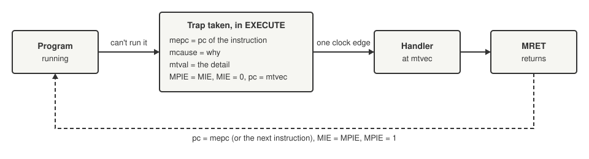

+++
date = '2026-10-19T00:10:00+11:00'
draft = false
title = 'RISC-V soft core 5: When it goes wrong on purpose'
description = "Making an illegal instruction trap instead of becoming a nop: CSRs, mepc and mcause, MRET, and where the Zicsr extension fits in a RISC-V core."
author = 'Dean Sellers'
tags = [
    "riscv-cpu",
    "riscv",
    "fpga",
    "traps",
    "exceptions",
    "hardware"
]
+++

# When it goes wrong on purpose: traps

*Part 5 of the RISC-V soft core series. Previously: [Talking to the world]().*

Up to now, if the core was handed an instruction it did not understand, it treated it as a `nop` and carried on. That is the worst possible answer. A program that goes wrong should *stop and say so*, and the rest of the machine should be able to decide what to do about it.

That is what a trap is, and it was the moment the core started to look like a real processor. We are writing to a spec, and the spec is clear: an illegal instruction is an *exception*, and exceptions take the core to a handler.

## What a trap does

A trap is a jump with some bookkeeping. The bookkeeping lives in a small set of registers called CSRs, control and status registers, and RISC-V has instructions to read and write them (the Zicsr extension, more on that below).

*What a trap does. Everything in the second box happens on one clock edge.*

### Extensions, and where Zicsr fits

RISC-V is a small base instruction set plus optional **extensions**, and the names are worth decoding because they will keep turning up. This core is **RV32E**: `RV32` is 32 bit, and `E` is the base set with 16 registers (the bigger `I` base has 32). Single letter extensions add whole families of instructions, such as `M` for multiply and divide, which comes up in [part 10](). The longer names starting with `Z` are smaller, more specialised extensions: the second letter says which family it belongs to (`i` for the integer side) and the rest says what it is. So **Zicsr** is the instructions for reading and writing control and status registers, and **Zifencei** is the instruction fetch fence from [part 3](). Zicsr used to be part of the base set and was split out into its own extension in a later version of the spec, which tells you how much the CSRs are a separate idea from computing.

This is the first time the project has needed one. Every instruction so far came from the base set, and from here the core also has the six Zicsr instructions (`csrrw`, `csrrs`, `csrrc` and their immediate forms) plus `mret`, `ecall` and `ebreak`.

### The registers a trap touches

Every CSR name starts with `m` for **machine mode**, the most privileged level and the only one this core has. Here are the ones a trap uses.

| Name | Stands for | What it does |
|---|---|---|
| `mepc` | machine exception program counter | the address of the instruction that trapped, so `MRET` knows where to come back to |
| `mcause` | machine cause | why: a number, from the table of causes below |
| `mtval` | machine trap value | a detail, such as the bad instruction word or the bad address |
| `mstatus` | machine status | holds the interrupt enable bits `MIE` and `MPIE` |
| `MIE` | machine interrupt enable | a bit in `mstatus`: interrupts are accepted while it is 1 |
| `MPIE` | machine previous interrupt enable | a bit in `mstatus`: a trap copies `MIE` here and clears `MIE`, so the handler is not interrupted halfway |
| `mtvec` | machine trap vector | the address of the handler, which the program counter is loaded from |

Two more, `mie` and `mip` (interrupt enable and interrupt pending, per source), only matter once there are interrupts, so they wait for the next part.

When the handler is done, `MRET` undoes the lot: the program counter comes back from `mepc`, `MIE` from `MPIE`.

One small quirk: `mtvec` is 0 after reset. A trap before the program has set it sends the core back to address 0, and the program simply starts again. I rather like that. A program that crashes early reboots.

## What counts as an error

| Cause | Number | `mtval` |
|---|---|---|
| A jump or taken branch to a misaligned target | 0 | the target |
| Illegal instruction | 2 | the instruction word |
| `ebreak` | 3 | 0 |
| Misaligned load | 4 | the address |
| Misaligned store | 6 | the address |
| `ecall` | 11 | 0 |

An untaken branch to a bad target does not trap, because it was never going to go there. And a `jalr` to an odd address does not trap either, because the spec says the low bit is cleared. Both of those I put in a test, because they are the kind of thing a core gets wrong by trapping too eagerly.

## How it fits this state machine

The core is a multicycle machine, so a trap fits easily. A small combinational unit decides in EXECUTE whether the instruction traps. If it does, the state machine takes the trap *instead of* anything else the instruction would have done and goes straight back to FETCH, with the next address set to `mtvec`.

Two things fall out for free:

- **A trapping load or store never reaches MEM_ACCESS.** No read happens, no write happens, no register is written, and no extra clocks are spent. The bad instruction has no effect at all, which is exactly what the spec asks for.
- **A trap costs two clocks.** The memory port already carries the next address on that edge, so the handler's first instruction arrives at the next FETCH, using the same prefetch trick as every other jump.

## The test that could lie

Testing traps was where the habits of part 2 earned their keep.

I wrote one program, `ILLEGAL`, that feeds the core thirteen illegal encodings: 64 bit loads and stores, a register that RV32E does not have, a CSR that does not exist, a write to a read only CSR, a branch with a bad `funct3`, and more. Each one traps to a shared handler that records `mcause`, `mtval` and `mstatus`. A second program, `TRAPS`, covers the exceptions that are legal but unusual: `ecall` and `ebreak` with interrupts enabled, misaligned loads and stores, and the two jump cases above.

The model, `rv32sim`, takes traps exactly as the core does, but with a twist: it *raises an error* on any trap in a program that is not on a list of programs expected to trap. So a typo in a normal test cannot pass off as an expected trap.

Mutation checks went through the usual routine. A trap that leaves `mepc` alone, a trap that leaves `MIE` set, `mtval` always 0, an untaken branch that traps, a misaligned store that does not: all caught.

And one that was not, at first. I made `mstatus` take its `MIE` bit from bit 2 of the written value instead of bit 3, and the test still passed. The program only ever wrote `0x08` and all ones to `mstatus`, and after the `MRET` the result was the same either way. The test had to be changed to *read back* `mstatus` right after the write, so the wrong bit showed up.

## A collision with an older test

There was one awkward moment. The old `ILLEGAL` test used a CSR write to `mstatus` as its example of an instruction that must be illegal "because there are no CSRs". Once CSRs existed, that word became *legal*, and the test would have quietly written `mstatus`. I changed it to a CSR that is not implemented. It is a good example of a test whose meaning changes underneath you when the thing it tests grows.

## The price of a check

Everything has a cost, and the CSRs showed it in two places.

First, size. Adding the CSR file and the instructions cost about five hundred logic cells.

Second, speed, and this was the surprising one. The timing report for the CPU clock fell from 34.6 MHz to 28.4. It was not the CSR read mux, which only feeds the destination register. The cause was the decoder, which now includes a twelve bit compare of the CSR address in its "this is illegal" flag. That flag clears every side effect of the instruction, including the memory read, which sits at the front of the load address path. A comparison that looks small made a long path longer.

The cure, which I did a little later, was to decode in FETCH and store the result, so the long path starts at a flip flop. That, and the register read moved to FETCH too, won back some of it. The point is that the cost of a new feature is rarely where you expect it.

## What I learned

A trap is not a special mechanism. It is a jump, plus a handful of registers that remember where you were and why. What makes it feel significant is that it lets the machine tell the difference between *I was told to do this* and *something went wrong*, and a program that can survive the second one is a different thing from a program that cannot.

Next time, [the other kind of interruption](): not a mistake in the program, but the outside world knocking on the door. Timers, buttons, and the press that got lost.
