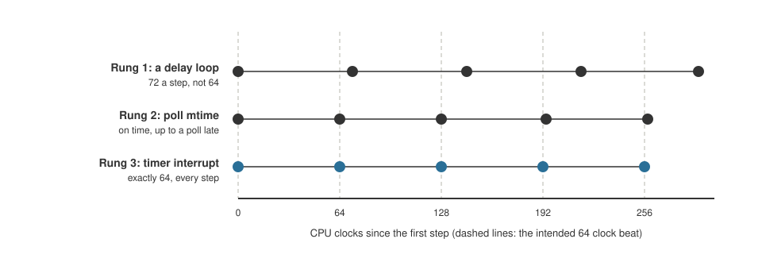
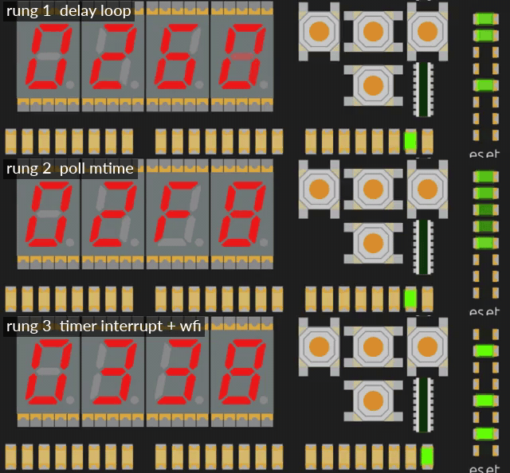

+++
date = '2026-10-19T00:15:00+11:00'
draft = false
title = 'RISC-V soft core 6: Time and interrupts'
author = 'Dean Sellers'
tags = [
    "riscv-cpu",
    "riscv",
    "fpga",
    "interrupts",
    "timers",
    "hardware"
]
+++

# Time and interrupts: a timer, some buttons, and the press that got lost

*Part 6 of the RISC-V soft core series. Previously: [When it goes wrong on purpose]().*

A trap is the program's own fault. An **interrupt** is the outside world getting the processor's attention, and the outside world does not wait for a convenient moment. It is the same mechanism with a different cause: the core stops what it is doing, remembers where it was, runs a handler, and goes back.

Interrupts sit at the heart of handling the real world inside a ticking machine. This project already has many opportunities to interface with real time. A timer that lets us measure real time is a good start, then buttons, UART IO, and more as we go on. I can't think of a system I have ever used that doesn't have some form of an interrupt system, I am sure they exist and have their niches, but I have never seen one.

## The timer

RISC-V's standard answer is a pair of 64 bit registers. `mtime` counts, and `mtimecmp` is a threshold. When `mtime` reaches `mtimecmp`, a flag called `MTIP` goes high, and if interrupts are enabled the core takes one. The program re-arms it by moving `mtimecmp` further on.

In this core the timer is a device in the memory map, like the UART. Taking the interrupt reuses the trap path from the last post, with no new state in the machine. The interrupt is decided in EXECUTE, taken *before* the instruction does anything, `mepc` points at that instruction so it runs after `MRET`, and `mcause` has its top bit set to say it was an interrupt rather than an exception. Two clocks, and an interrupted load or store never touches memory.

I made one deliberate deviation. The spec wants `mtime` to count at a constant rate in real time. In this machine it counted *CPU clocks*, because the CPU can be stopped, stepped and slowed down. A real time timer would fire constantly while I single stepped through a handler, and the interrupts would land at unpredictable instructions. Counting CPU clocks made every interrupt exactly reproducible, so the model could predict each one to the clock and the tests could check it. That choice came back to bite me, which is the subject of a later post.

## From Larson to an interrupt: a ladder

I wanted a way to feel what a timer is *for*. In a time when relay logic was a thing and PLC controllers were expensive I built a relay sequencer. Latching relays served as flip flops, timers delivered events. The outputs were conveyor motors, pneumatic gates and the like. So I took the Larson scanner and built it four ways, each a rung higher.



*The model's count of when each step lands, with the timer counting CPU clocks as it did when I built the ladder. The dashed lines are the intended beat.*



*The same scanner on three rungs, in simulation. The LEDs match by design, so watch the program counter on the seven segment display and the Cu's column of LEDs instead: the counter wanders through the delay loop and the polling loop, and stops dead on the wfi.*

**Rung 0, the original.** A straight run of shifts and a jump. The position of the light lives in the *program counter*. The program has no idea of time at all, and each step is one instruction. The clock switch is the only speed control. It is a stepping switch, advanced by every pulse.

**Rung 1, a delay loop.** After each shift, count a register down to zero. Time is *counted in instructions*, so you have to know what every instruction costs on this machine. I aimed for 64 clocks a step and the model said 72. Eight clocks of overhead that nobody had counted: the shift, the jump into the loop, setting up the count, and the return. At the turnaround it was 74. The CPU does nothing else while it waits.

**Rung 2, poll the timer.** After each shift, read `mtime` and wait until a deadline, then move the deadline on *from the last deadline, not from now*. That is the trick: overhead does not accumulate, so the beat is 64 clocks. There is jitter, up to one pass of the polling loop. After the turnaround the step landed 66 clocks after the last and stayed on the shifted phase. It is bounded, with no drift. But the CPU is still busy.

**Rung 3, the interrupt.** The main loop is just `wfi` (wait for interrupt) and a jump back. When the timer fires, a handler does *one step* and moves `mtimecmp` on by the period. Exactly 64 clocks a step, turnaround included, because the interrupt is taken at a fixed point.

The structural change is the point. The position of the light moved out of the program counter and into registers. The straight line of shifts became a **state machine stepped by events**. That is a relay sequencer: the dial timer closes a contact and the stepping relay advances once.

## The buttons

The four direction buttons on the Io board are the second source. The path from a finger to the CPU is a good small example of everything I have said about domains. A human press is slow, bouncy and random. It goes through a debouncer, then through two flip flops to bring it into the CPU's clock, and then into a **pending bit**: each rising edge sets the bit, and it stays set until software writes a 1 to it.

A button interrupt takes priority over the timer, which is the spec's order, and has `mcause` `0x8000000B`.

Two things about that pending bit turned out to matter.

**A press on the clearing edge is not lost.** What happens when a press lands on exactly the clock where software clears the bit? Not undefined. After the synchroniser everything is on the CPU clock, so each case has one outcome. The bit is set by the press and cleared by the write on the same edge, and **the set wins**: the bit stays, and another interrupt follows. I wrote a test with a press timed to that one clock, and the mutation "clear wins" fails it.

**A press that is merged is lost.** If a *second* press of the same button arrives while its pending bit is still set, there is nothing to record it. The OR finds the bit already 1, and the handler's clear removes both. Two presses, one interrupt. A pending bit does not count, it says "at least one press since you last looked". Edge latched interrupt flags generally work this way.

I first got the window wrong. I told myself it was the few clocks between the handler's read and its clear. Then I checked with the model, and a second press *before* the read merges too, because the read just sees one bit. The real window runs from the first press becoming pending until the handler clears it: the interrupt latency, the handler's setup, the read and the clear. At the fast clock that is microseconds and no human hits it. At the slow clock it is hundreds of milliseconds, and a quick double tap does.

## Reporting what you cannot keep

I considered four fixes, cheapest first:

1. An **overrun bit** per button. It cannot keep the press, but software finds out that it lost one, as a UART reports receive overrun. Four flip flops.
2. **Clear earlier** in the handler, which shrinks the window but cannot close it.
3. A **press counter** per button instead of a bit, with a race free clear. More logic.
4. An **event FIFO** with a timestamp for each press. Keeps everything, costs the most.

For a front panel the first is the right size. I built that, and left the others as notes.

Here is what it looks like in practice, from the simulator in slow mode. The demo prints a line from the handler for each interrupt, and I pressed buttons quickly:

```text
buttons 2
buttons D
buttons 2
buttons F lost D
```

The number is a mask, one bit per button: up is 1, down 2, left 4 and right 8. On the last line `F` says all four had a press pending. `lost D` is the overrun mask: `D` is 1101 in binary, so up, left and right each had a second press merged into the first inside one window. Down's two presses straddled a clear, so neither was lost. It is easy to read "lost" as a count that has hit a limit. It is not a counter. It is a mask, and an overrun bit can only say "more than one".

The handler also prints while interrupts are off, so presses during the print pile up for the next handler. That is the real cure for later: the handler should not sit in the interrupt for the whole of a slow print.

## A test with gaps

The first interrupt test passed, and then I asked what each mutation would do to it, and it had holes. The button interrupt was always enabled before the global enable, so "ignores the button enable" would pass. And the timer and the button were never pending at the same time, so a swapped priority would pass.

So I rewrote it to enable and disable each source on its own, and to make the timer and a press pending together with interrupts off, so enabling takes the button first and then the timer. Then the mutations that mattered all failed.

## What I learned

An interrupt is a trap with a different cause, and what is hard about it is not the mechanism but the *timing*: what happens at the edge, what a flag can and cannot remember, and what you do when two things happen together. The buttons taught me that "the press that got lost" is not a bug to remove. It is a decision about what a pending bit means.

Next time, [the clock itself](). How the core went from two clocks to one, and why slow mode cannot show you real time.
