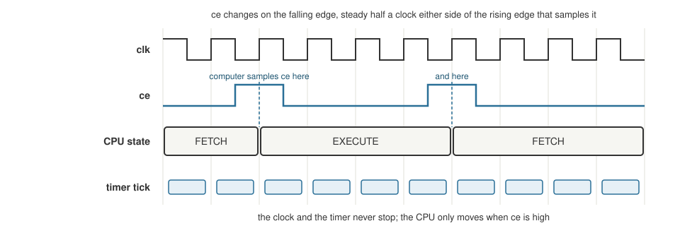

+++
date = '2026-10-19T00:20:00+11:00'
draft = false
title = 'RISC-V soft core 7: One clock'
description = "Why a divided CPU clock cannot do real time, and how moving the soft core onto one board clock with clock enables fixed it."
author = 'Dean Sellers'
tags = [
    "riscv-cpu",
    "riscv",
    "fpga",
    "clocks",
    "time-domains",
    "hardware"
]
+++

# One clock, and why slow mode cannot do real time

*Part 7 of the RISC-V soft core series. Previously: [Time and interrupts]().*

For most of this project the core had two clocks. There was the board's fast oscillator, which ran the UART, the display and the debouncers, and there was the *CPU clock*, which the front panel made by dividing the fast one and which it could stop, start and single step.

It worked, and it nagged at me, why can't the core just run at the board's speed, and have a tick per second that is properly grounded in real time? The real time domain is where we all live and where the important stuff happens, why aren't we tied to it?

## Why not just go faster

It was not about resources. The design used about two thirds of the chip. It was about speed. The longest path in one EXECUTE clock goes from the operand registers through the 32 bit adder and compare, to the address, through the address decode and the read mux, and into a flip flop. That is about thirty nanoseconds, three quarters of it routing. On this family of FPGA that means about 33 MHz. Running at the board's 100 MHz would need that path cut into three or more stages, and that is a pipeline, a different machine.

That is not a defect. Small 32 bit cores on this family run well under 100 MHz. So the clock could stay slow. The question was where the clock came from.

## The real flaw

The CPU clock was **made by logic** and **stopped and started by the front panel**. Everything awkward followed from that:

- `mtime` had to count CPU clocks, or the timer would race ahead while the CPU was stopped,
- a real `wfi`, wait for interrupt, was a chicken and egg: stop the CPU clock to save power and you stop the timer, and the timer was the only thing that could wake it,
- the simulator crawled behind a divider,
- the timing report saw an odd generated clock,
- and it used up a second global clock buffer.

The textbook way on an FPGA is the opposite: **one real clock that never stops, and clock enables** that say which flip flops may change on a given edge.

## The design

*The clock and the timer never stop. The CPU takes a step only on a rising edge where `ce` is high.*

- The FPGA's PLL makes a fixed 25 MHz from the 100 MHz oscillator. That is under the core's speed, so every path meets timing honestly.
- **Everything runs on that one clock**: the core, the RAM, the UART, the debouncers, the display. There are no clock domain crossings left inside the design, and the UART's toggle handshake from part 4 could in principle go.
- The front panel drives a clock enable, `ce`, instead of making clock edges. **Stop** is `ce` held low. **Step** is one pulse, or pulses until the CPU is back at FETCH for a whole instruction. **Slow run** is a pulse about every million clocks, around 24 a second. **Fast** is `ce` on every clock, so the CPU is clocked at the full 25 MHz.
- Every module in the CPU's world gets a hold at the end of its `always` block: if `ce` is low, each flip flop keeps its value.
- `mtime` runs on the free running clock. It counts real time whatever the front panel is doing.

Tests stay exact, because the testbenches hold `ce` high and tick every clock, so "`mtime` equals clocks" is still true in the model.

## Two attempts that did not work

The first plan put `ce` on the rising edge of the clock, like everything else. **The computer ignored every pulse.** A debug testbench showed `ce` pulses being issued and the CPU state never moving, every run. It was the simulator's ordering problem from [the simulator thread](): the machine's `ce` flip flop fed another instance, which saw it from the wrong side of the edge.

The second attempt moved only `ce` to the *falling* edge. Now the pulses worked, but a clock step never ended. The decision to pulse was made on the falling edge and the bookkeeping on the rising edge, half a clock apart, so the bookkeeping saw a different version of the conditions and never recorded the pulse. That was my own bug.

The fix was to put **the whole sequencer on the falling edge** and the computer on the rising edge. Now `ce` is steady for half a clock either side of every edge the computer samples it on, as the diagram shows. Neither the simulator's ordering nor a slow wire on a real chip should be able to catch it halfway. The build maps the falling edge sequencer to flip flops that can invert their clock, so there is no inverter on the clock and no extra buffer.

A mutation put the sequencer back on the rising edge, and the test for the front panel failed with the original symptom.

## A warning that was a real bug

When the hardware counts were rebuilt for 25 MHz, the first build said: "Range select [15:14] out of bounds ... setting all 2 result bits to undef" in the display code. A divider constant had been emitted at four bits, and a counter sized as the divider plus 2 wrapped round: 14 plus 2 is 16, which is 0 in four bits. The digit select came out undefined.

Everything else passed. The checks, the simulator and the whole test suite all passed, because the Lucid simulator does its own arithmetic. The build's own warning was the only sign. The build also came out *smaller* than expected, which was a symptom too: the tools had deleted the display logic that the undefined select had made dead. A number that is too good is worth a second look. The fix was to pass the final width as the parameter and only subtract inside the module.

## Real time at last

With `mtime` on the free running clock, a tick every `TICK_DIV` clocks, 25 on the board build for one microsecond, the timer no longer cares what the front panel does. It keeps counting while the CPU is stopped, stepping or crawling. A `STOPTIME` option keeps the old behaviour, counting only enabled clocks, like the debug spec's stop on halt.

And a real `wfi` became possible. The CPU waits in EXECUTE until an interrupt that is enabled is pending, and the timer, still running, can be the thing that wakes it.

The timing ladder from the last post shows what changed. Rung 1, the delay loop, counts *instructions*, so it still follows the front panel's speed switches. Rungs 2 and 3 read the timer, so they keep their speed whatever the CPU clock does. That is the demonstration of why delay loops are a poor way to measure time. I added a read-only timebase word, so a delay loop can calibrate itself from the timer's divider.

## Slow mode is for logic

This is the lesson I keep having to relearn. **Slow mode is for watching logic: state lights, the program counter, one instruction at a time. It is not for anything that is timed against real time.**

Slow mode makes the CPU crawl at about 24 clocks a second, but `mtime` still ticks at a microsecond. A timer period that looks long to a human is a handful of CPU clocks. By the time the handler has finished and the CPU is back in `wfi`, the deadline has already passed. The core never gets to wait. I will show the actual case in the next post. If you want timed behaviour to look like the board's, run it fast, in the simulator at the board's pace, or in the tests with a clock enable.

## What I learned

Time has more than one domain in a design like this: the clock that steps the logic, and the wall clock the world lives in. Mixing them in one counter worked until it had to be real. Separating them took one clock, an enable, and a pair of edges, and the rest of the design got simpler.

Next time, what a processor does when it has nothing to do: [sleeping]().
