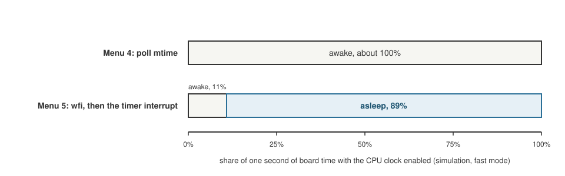
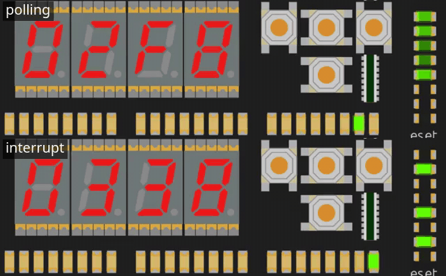

+++
date = '2026-10-19T00:30:00+11:00'
draft = false
title = 'RISC-V soft core 8: Sleeping, and measuring it'
author = 'Dean Sellers'
tags = [
    "riscv-cpu",
    "riscv",
    "fpga",
    "sleep",
    "wfi",
    "hardware"
]
+++

# Sleeping, and measuring it

*Part 8 of the RISC-V soft core series. Previously: [One clock]().*

What should a processor do when it has nothing to do? The honest answer from the timing ladder in part 6 was: *burn every clock*. The final rung of that ladder sat in a loop of `wfi` and a jump back, and `wfi` was a no-op, so the CPU spun at full speed waiting for a timer that was not due.

RISC-V has an instruction for this: **WFI, wait for interrupt.** It tells the core it may stop until something wants attention. The idea sits behind most battery powered devices. Now that the timer runs on a real time clock that never stops, WFI can really wait, and the machine can really stop.

## What sleeping means here

Inside this core, nothing dramatic. WFI parks the CPU in its EXECUTE state until an interrupt that is *enabled* in `mie` is pending. If interrupts are globally on, it takes the interrupt, with the return address after the WFI. If not, WFI completes and carries on. A WFI with nothing enabled waits forever, which the spec allows.

The new part is the machine around it. The control unit raises a flag, `sleeping`, when it is in EXECUTE on a WFI that has not been woken. The front panel's sequencer sees the flag and **stops issuing clock enables**. The CPU's clock does not tick at all until something wakes it. And it holds its pulse ready, so the first wake does not wait out the rest of a slow clock period.

*One second of board time in the simulator, fast mode, same Larson scanner, paced two ways. The CPU is awake for essentially all of it when it polls, and about 89 percent asleep when it waits in `wfi`.*

## What has to be always on

Here the time domain idea earns its keep. If the CPU's clock is stopped, who notices the thing that should wake it?

- **The timer** was already running on the free clock since part 7, so it can raise its flag with the CPU asleep.
- **The buttons** were not. Their synchroniser, their pending bits and their overrun bits all held still on a clock where the CPU was not enabled. A press landing between two slow CPU clocks would not be seen at all, and a sleeping machine would never wake for one.

So the buttons became **always on**. The whole receiving side runs on every clock, whatever the CPU is doing. Only the software side waits: a store that clears the bits applies on an enabled clock, and the read is captured on one. With the CPU running every clock, nothing changed, and every test stayed exactly as it was.

It is the same rule the UART receiver follows. Anything that has to notice the outside world lives on the free running side of the line.

## Testing it

A test for sleep has to show that the CPU really stopped *and* really woke. The generated testbench runs a WFI program in three ways: a timer wake in slow run, the case where interrupts are off and the WFI completes, and a button press in fast run. In each, it counts eighty clocks with the CPU clock light, the program counter and the state frozen, then checks the program counter leaves the WFI and the handler ran.

And a mutation: set `sleeping` to always 0. The test fails at the first comparison of the clock light, which is the symptom I wanted it to show.

## A light for it, and a wrong assumption

I wanted to *see* the machine sleep. The front panel has four LEDs showing the state and one that toggles on every CPU clock. My instinct said that while asleep the clock LED "blinks only during wakes, then freezes with the EXECUTE light on."

That was wrong in detail, and I had not really paid attention to the window. The clock LED toggles on every pulse, so asleep it freezes at **whatever level the last burst of pulses left it**, lit or dark, not at a particular one. I had only checked counts.

The simple fix was an extra light. LED 6, the "busy" light, was nearly useless: it means "a step is being finished", which lasts a couple of hundred nanoseconds. Now it also lights while the machine is **asleep**. The two can never overlap, because busy needs the machine stopped and sleeping needs it running. It also gives me a scope point to measure utilisation, when hardware arrives.

*Polling (top) against the timer interrupt (bottom), in simulation. Underneath, the cpu clock LED freezes and LED 6 lights while the machine sleeps.*

## The sleep that never showed

Then came the question that taught me the most. I ran menu 5, the interrupt driven Larson, in the simulator, in slow mode. **LED 6 never lit.** Only in fast mode.

My first reading was that the CPU should be asleep between every step, because that is what the program does. It was not, and the reason is the lesson of the last post. In slow mode the CPU runs about 24 clocks a second, and `mtime` ticks every microsecond. The step period at the largest dial setting is a quarter of a second at most, which is about six CPU clocks. The handler and the loop together are dozens of instructions. By the time the CPU gets back to the `wfi`, the deadline has passed, the timer flag is already high, and the WFI wakes at once. It never sleeps.

That is an overload, not a bug. It is exactly why **slow mode cannot show real time**: the CPU is too slow to do its work inside the timer's period. If you want to see sleeping, run fast.

## Measuring it

Which brings me to the measurement I wanted. How much does sleeping actually save? In the simulator I can count the CPU clock enables over a second of board time, and compare the two ways of pacing the scanner, at the same dial setting:

| Menu | Pacing | CPU clocks enabled in one second |
|---|---|---|
| 4 | poll `mtime` in a loop | 4,999,976 of 5,000,000 |
| 5 | `wfi`, wake on the timer | 537,975 of 5,000,000 |

So the polling version has the CPU enabled all the time. The interrupt version has it enabled about **11 percent** of the time, and **asleep for about 89 percent**. That is the duty cycle of LED 6, if the design behaves on a board as it does here.

A side effect I did not expect: the simulator itself runs faster asleep. It ran about 30 percent faster in the sleeping menu than in the polling one, because Verilator does less work when little is switching. I wondered whether sleeping would make the simulation faster, and the instinct was no, since every flip flop is still evaluated. The measurement says different, which is why measuring is good.

## What it does not tell me

This is all simulation. The percentages come from counting clock enables, and say nothing about the power a real chip would draw. On an FPGA the clock tree keeps running, and the logic that is idle still takes its static current, so the saving is mostly a *saving of work*, not necessarily of watts. The place to put a number on the real thing is a scope on LED 6 on the board: the duty cycle should come out near the 89 percent, and the width of the low pulses should tell me how many clocks each interrupt costs. (Since measured, on the board: [part 14]() has the low pulses at about 34 clocks a tick. The 89 percent duty cycle is a different program and I haven't measured it.)

## What I learned

A sleep is a promise that the world can reach you. The rest of the machine has to be built so that it can: the timer on the free clock, the buttons always listening, the sequencer watching a flag. The CPU stopping was the easy part.

And the numbers were the argument. Eleven percent awake is a better way to say "it sleeps" than a diagram.

Next time, the point of the whole exercise: [C on the core]().
