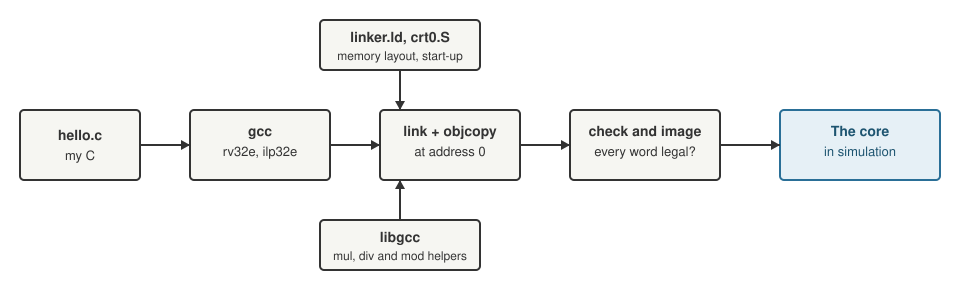

+++
date = '2026-10-19T00:35:00+11:00'
draft = false
title = 'RISC-V soft core 9: First C on the core'
description = "The first compiled C program on the RISC-V soft core: the rv32e cross compiler, a linker script, a start-up file and what it took to run hello.c."
author = 'Dean Sellers'
tags = [
    "riscv-cpu",
    "riscv",
    "fpga",
    "c",
    "toolchain",
    "hardware"
]
+++

# First C on the core

*Part 9 of the RISC-V soft core series. Previously: [Sleeping, and measuring it]().*

Back in [part 0]() I said the reason for choosing RISC-V over a machine of my own design was that the compiler already exists. It was a promise I had not yet kept. Everything the core had run so far was assembly I wrote or generated for the tests.

This post is the first time a compiler's output ran on it. It is also where the thing I built stops being a toy and starts being something you could write programs for.

## What you need

A cross compiler. On Ubuntu that is the `gcc-riscv64-unknown-elf` package, and it ships a multilib for exactly this machine: `rv32e` with the `ilp32e` ABI. That means 32 bit, sixteen registers, no multiply, no compressed instructions. The ELF files it makes are tagged `rv32e1p9`.



*From C source to the core. The last box is a simulation so far.*

Then three things of my own, none of them large.

**A linker script.** One address space, so everything goes in the 8 KB RAM, starting at address 0. There is no copy of `.data` from somewhere else at start up, because the RAM's initial contents *are* the program: there is no load address different from the run address. The stack grows down from the top of RAM.

**A start up file.** `crt0.S` runs first, because the reset address is 0:

```text
_start:
    la      sp, _stack_top          # the stack
    la      gp, __global_pointer$   # more on this below
    la      t0, trap                # mtvec: a trap halts here, because the
    csrw    mtvec, t0               # reset value, 0, would silently restart
    ...zero the .bss...
    call    main
halt:
    j       halt
```

**A way to print.** The UART from part 4, polled:

```text
static inline void putc_(char c) {
    while (UART_STATUS & 1) ;       /* wait until the transmitter is idle */
    UART_TXDATA = (unsigned char)c;
}
```

And a program that prints a greeting, then `6 * 7`, `100 / 7` and `100 % 7`.

## A checker between the compiler and the core

I did not want to trust the compiler's output blindly, because the core only implements what the spec lets an RV32E have, and it traps on anything else. So a script, `cbuild.py`, compiles and links the program, and then checks **every instruction word in the code** against the model's list of legal encodings, the same list the decoder is tested against. The image and a listing are committed, so generating the tests does not need a compiler.

The result for the first program: a little over a hundred and fifty instructions, every one of them legal.

## Three wrong turns

**The program loaded from `0xFFFFF81C`.** The first run in the model read from a nonsense address and fell over. The compiler had *relaxed* some accesses into a global pointer relative form, using the global pointer register as a base. The linker defines the value of `__global_pointer$` when there is a small data section, and my start up file had left `gp` at 0. Negative offsets from zero. The fix was to load `gp` in the start up file, with the linker's relaxation switched off for that one line.

**Every data word was "illegal".** My first checker scanned the `.data` section as if it were code, and every constant came out as an illegal instruction. Only the range from 0 to the end of the `.text` section is code. I gave the linker script a symbol, `_etext`, for the end of code.

**The compiler did the sum.** My first test program computed `6 * 7` and printed 42. The model showed no call to a multiply routine at all. With optimisation on, the compiler had folded the arithmetic away at compile time, so there was nothing to test. The inputs had to be `volatile`, which forces it to do the work at run time.

## No multiply in the hardware

That last point matters. The core has no M extension, so there is no `mul`, `div` or `rem` instruction. When C says `a * b`, the compiler calls a library routine, `__mulsi3`, from the compiler's own support library, libgcc. The same for division and remainder. They are loops of shifts and adds, and they run on the core as ordinary code.

That detail is the subject of the next post. Here it only means that the first program, with its three operators, was also the first thing to exercise a substantial slice of library code.

## Does it work?

The model ran the program in 824 instructions and printed the expected two lines, then halted at the loop in the start up file. Then the same program ran in the Verilog under Yosys and printed 23 bytes, and in the Alchitry simulator. All three agreed.

And a mutation, to see whether the check could fail. In a scratch copy of the generated ALU I made `srl`, the shift right, shift one place further. The output changed from `42 14 r2` to:

```text
0B 5 r2]
```

The numbers were wrong and the line was garbled. A test that fails like that is a test that can tell.

## From a test to a demo

A test program is not much fun to look at. I wanted C to be something I could run on the front panel, so it became the last entry in the boot menu from part 4. The menu stub jumps to address `0x800`, where the C demo is linked, above the other demos, which end at `0x4FC`. The start up file is position independent, so it runs from there as readily as from 0.

In the simulator, with the switches set for fast and menu 7:

```text
Hello from C!
42 14 r2

clocks per call, tick = 5 clk
mul 0x00000006 0x00000007: 55
...
type: 
```

The greeting is from this post's program. The table is the next post's. And after the prompt it echoes whatever you type, using the UART receiver from part 4.

## The staircase

One small thing I enjoyed. When I ran the demo with a serial terminal attached to the simulator's pseudo terminal, the output went down the screen in a **staircase**, each line starting where the last one ended.

The program ended lines with a bare line feed, `\n`. A raw serial terminal does not add the carriage return, so the cursor moved down and not back. The simulator's own printout did not show it, because that goes to a normal terminal, which *does* add one. The menu's own strings already used `\r\n`. I changed the C demo to match.

It is a reminder that the test and the real thing can disagree about something as basic as the end of a line.

## What is not done

No `printf`. No standard library, so no `memcpy` or `memset` unless the compiler asks for one, and then I will provide it. No interrupts written in C, which need a handler that saves its registers. No bootloader, so a new program still means regenerating the image. And I have not run the same file on an independent reference, QEMU or Spike, to compare. Those are all on the list.

## What I learned

This is the moment the earlier posts were for. The decoder, the traps, the memory map and the tests were all ways of making the core *worth running a compiler on*. Nearly all the effort of getting the first C program running went into my start up file and my test harness. The core did not need to change for it.

That is the whole argument for choosing an instruction set that already has a toolchain.

Next time, [what a multiply costs]().
