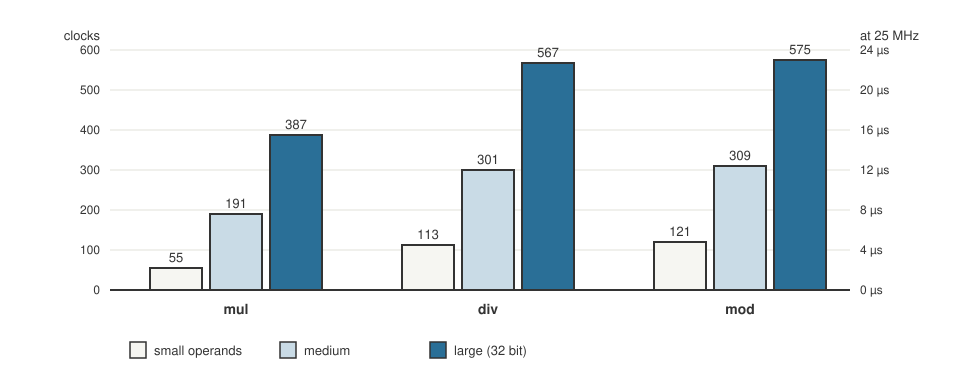

+++
date = '2026-10-19T00:40:00+11:00'
draft = false
title = 'RISC-V soft core 10: What does a multiply cost?'
description = "With no M extension, a multiply is a library loop. Timing mul, div and rem from inside the program using mtime on an RV32E soft core."
author = 'Dean Sellers'
tags = [
    "riscv-cpu",
    "riscv",
    "fpga",
    "c",
    "performance",
    "hardware"
]
+++

# What does a multiply cost?

*Part 10 of the RISC-V soft core series. Previously: [First C on the core]().*

The first C program had a line in it that looks harmless: `a * b`. On a modern laptop that is one instruction and a few clock cycles. On this core there is no instruction for it. The core is RV32E with **no M extension**, so no `mul`, no `div` and no `rem`. The compiler turns each `*`, `/` and `%` into a call to a library routine, a loop of shifts and adds that runs as ordinary code.

How much does that cost? I did not want to guess, and I realised I did not have to, because the core has the thing needed to measure it.

## A clock the program can read

I wondered whether the program could print its own cost, in our time, real time. Of course, we have real time, `mtime` is a free running counter in the memory map, and a read-only word beside it says how many clocks make a tick.

So the program can time itself. The recipe in `cost.c`:

- call the operation sixteen times, through a function pointer and `noinline` wrappers, with `volatile` operands, so the compiler cannot fold anything away or optimise the calls out,
- time the same loop around a function that just returns its first argument, and subtract it, so the loop, the call and the operand loads cancel,
- print `(ticks * clocks per tick) / 16`: clocks per call.

The operands are picked for how the library loops behave. The multiplier has 3, 16 and 32 bits. The quotient has 4, 17 and 32.

## The table

*Clocks for one call, wrapper included. The right hand axis is microseconds if the clock is 25 MHz, which is what the build is made for.*

| Operation | Small | Medium | Large |
|---|---|---|---|
| `mul` | 55 | 191 | 387 |
| `div` | 113 | 301 | 567 |
| `mod` | 121 | 309 | 575 |

At 25 MHz that is about **2 microseconds** for a small multiply and about **23 microseconds** for a remainder of a full 32 bit number. The same table appears in the simulator's window, to within a clock or so, because the simulator's tick is five clocks and it averages over sixteen calls.

## What the numbers say

The cost is not a fixed number. It **grows with the size of the operands**: roughly ten to twelve clocks per bit of the multiplier, and seventeen to nineteen per bit of the quotient. A multiply by a small constant is cheap. A 32 by 32 multiply is not. A remainder is about the same as a divide, which fits: it is the other half of the same division.

That is the argument for or against a hardware multiplier, in numbers:

- A multi cycle multiplier, one step per bit, would be about 32 clocks *flat*. The large case would drop from 387 to roughly a tenth.
- A step that handles two bits at a time would halve that again.
- It costs logic. The core is already about two thirds of the chip. I have not decided, and these numbers are how I will.

For a program that multiplies rarely, or by small numbers, the library is fine. For a program that does a lot of arithmetic on full size values, it is the first thing I would change.

## Two wrong turns in the measurement

**Printing the operands cost more than the operations.** My first version printed the operands in decimal. The model ran 44,927 instructions and then the test generator refused it: "no halt after 20000 instructions."

The reason is that printing a ten digit number in decimal is a stack of divides and remainders, one pair for every digit, and each one costs up to about 570 clocks. I was spending more time printing what I was measuring than measuring it. The operands now print in hex, which is shifts and no divides. It dropped the whole run to about 31,000 instructions and 66,000 clocks.

**The program restarted at clock 65,536.** In the Yosys simulation the run went wrong halfway and then started again from the beginning. It was not the core. A harness counter that tells the reset when to end was **sixteen bits wide**, so when the count reached 2 to the power 16 it wrapped to 0 and the harness reset the core again. I found it by tracing the program counter: the last values before the restart were ordinary library loop code, and the restart landed at exactly that round number. No earlier test had run 65,000 clocks. I widened it to 32 bits, and the generated testbench had the same fault in a counter that only drives scheduled button presses, where nothing had gone wrong.

There was a third, smaller one: the run length was sized as three times the serial time plus a thousand clocks, which suits a program that mostly prints. This one spends sixty thousand clocks computing.

## The test that the Alchitry simulator could not run

I wrote a testbench for the program, too. It took **thirteen minutes** in the Alchitry simulator and failed on both full runs with the first byte wrong. I shortened it and instrumented it. Three more runs: two passed through byte 60, and one failed with a character received twice.

I could not reproduce the first failure, and I did not chase it. Yosys runs the same program on the same Verilog and passes every time, with the same bytes and the same cycle counts. And [the simulator thread]() has explained *why* the Alchitry simulator is a sample. The test is too slow to belong in the suite anyway, so it runs under Yosys only.

The mutation that matters for the measurement: make `mtime` count by 2, and every figure doubles and the test fails. So the table is tied to the timer.

## What I learned

The cost of a feature is a number, and you can have the number. The core already had a clock that counted real time. Once the program could read it, the machine could report on itself, and the argument for a hardware multiplier stopped being a feeling.

And the biggest cost in the first draft was my own printing. The thing being measured was not where the time went.

Next time, what I found when I went looking for the edges: [where it breaks]().
