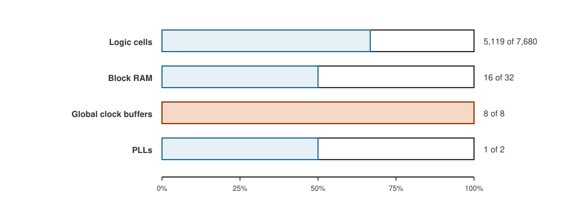

+++
date = '2026-10-19T00:45:00+11:00'
draft = true
title = 'RISC-V soft core 11: Where it breaks'
author = 'Dean Sellers'
tags = [
    "riscv-cpu",
    "riscv",
    "fpga",
    "debugging",
    "limits",
    "hardware"
]
+++

# Where it breaks

*Part 11 of the RISC-V soft core series. Previously: [What does a multiply cost?]().*

The point of this project was never only to build a CPU. It was to build one, make it run real code, and **find out where it breaks**. This post is that list. Some of the edges are bugs I found, and each of those has a story about how. Some are limits of the design, and they say what to build next. And one of them is bigger than all the others, and I will start there.

## The biggest edge: it has not met the board

Everything in this series is simulation. The design builds for the chip, passes timing, and agrees with a model under three simulators. It has **never run on a physical board**. Every claim about speed, power, timing and behaviour on the real thing is a prediction.

That is not a small caveat. It is the whole next chapter. Real hardware brings the things no simulator has: the actual clock, the pins and their voltages, switch and button bounce, and a serial cable and a terminal. If part of this series reads as if it was all working, that is a statement about the simulators and not about the chip.

## Bugs I found, and what found them

The more useful table is not the bugs but the **tools that found them**. No tool found everything.

| What went wrong | What found it |
|---|---|
| `5 - 7` came out as `0xFE` | the first unit test of the ALU |
| Every load returned `x`: the RAM was never simulated | a program test compared against the model |
| Three Cu LEDs were hidden by a silently widened shift | the first testbench of the board top |
| A display counter wrapped to zero: `14 + 2` in four bits | a build warning, and a build that came out too small |
| The core fetched word 0 forever in the IDE's board view | opening the IDE's board view, after 36 tests passed |
| A string terminator read as `x`: the RAM image had gaps | the Yosys simulation |
| A flip flop sampled another instance's value too early | a mutation that should not have failed |
| A byte sent twice by the UART | repeating a test until it failed, then logging the CPU |
| The simulator crashed at load, four runs in ten | counting start up crashes over ten runs of each version |
| A pending bit lost a second press | the model and a human with a button |
| `mtime` ticked on every clock | a video of a scrolling display |
| A 16 bit counter restarted a long test | tracing the program counter |
| The simulators' memory use took the desktop down | the desktop falling over, then a watchdog and a memory cap |

The shape of that table is the real finding. The tools overlap less than I had assumed. The first unit test, a board view, a build warning and a stopwatch on a video each found something the others would not have.

## Edges in the design

Not bugs, but the places where the design stops:

- **Slow mode cannot show timed behaviour.** The handler outlasts the timer period, so the interrupt driven rungs overload and sleep never shows. It is for watching logic, not time.
- **A pending bit holds one press.** The overrun bits report the rest. A counter or an event queue would keep them, and I chose not to build either for a demo.
- **A handler that prints sits in the interrupt for the whole line.** At one megabaud a byte takes about ten microseconds, and a second press during it is caught only by the pending and overrun bits. An interrupt driven UART with a queue is the cure, and it is not built.
- **The receiver holds one byte.** While the C demo is busy printing its table it is not reading the UART, so a typed character can be lost. A small queue in the receiver is the remedy if it matters.
- **A store over the next instruction runs the old word once.** It is allowed by the spec, and it is written into the model.
- **`FENCE.I` traps.** Zifencei is not implemented. It would be correct as a NOP on this core, but a loader or JIT that follows the spec would trap today.
- **A `wfi` with nothing enabled waits for ever.** The spec allows it.

## Edges in the numbers

*What the build uses of the iCE40 HX8K.*

**Space.** About two thirds of the logic cells, half the block RAM, and **all eight global clock buffers**. That last one is the tight spot: only one is a real clock, and the rest are promoted resets and enables, so a new clock would bump a reset off.

**Speed.** The build is made for 25 MHz and the timing report says about 30. The CPI is 2 for most instructions, 3 for a store and 4 for a load. The critical path runs from a register through the jump target, the misalignment check, the trap decision, the next address, and the address decode to a read enable. About three quarters of its delay is routing.

Every gain cost something. The CSR address check cost about six megahertz. Decoding in FETCH won some of it back.

There is a wrong turn in here I would not skip. One build of a branch reported 28.8 MHz against main's 34.1, and I blamed the wider interrupt cause I had added. I ran ablation builds: removing the platform terms, narrowing the field back. Nothing tracked the logic. The critical path was the same path in both and had nothing to do with the interrupt cause. Then the same logic rebuilt on top of main reported **33.4 MHz**. The spread from 28 to 34 was **placement noise**, and the "widening costs 2.5 MHz" claim had never been demonstrated.

The lesson is two sentences. One build is a sample. And a path report names the logic that is slow, not the logic you changed.

## What is not there

- no `mcycle` or `minstret`, so a program cannot count its own cycles except through `mtime`,
- no hardware multiply or divide, with a table showing what that costs,
- no `printf` or standard library, so only what I write myself,
- no precise access fault, because a fetch from I/O reads zero and traps as illegal,
- no bootloader, so a new program means regenerating the image,
- no run against an independent reference, such as QEMU, Spike or the official architecture tests,
- and nothing yet exercises a load from an unmapped address: the model refuses it.

## Where it goes next

A few of these are cheap. An interrupt driven UART with a queue, a receive queue, and `FENCE.I` as a NOP could each be done in a sitting.

Two are bigger, and they pull in different directions. A **hardware multiplier** is the answer to the cost table, and it would spend logic cells that are already two thirds used. A **pipeline** would speed everything up, and it is a different machine: the prefetch trick, the fixed two clock rhythm and every lockstep test depend on the core finishing an instruction before it starts the next.

And before any of them, the **board**. That is the edge that decides which of the others are real.

## What I learned

The list of where it breaks is not an apology. It is the useful output of the project. Every edge on it is a question I know to ask, and for most of them I know which tool will answer it. The most valuable habit was not writing tests. It was writing a test, then breaking the design to see whether the test noticed.

Next time, [the scanner, third time](): the same program again, now a system.
