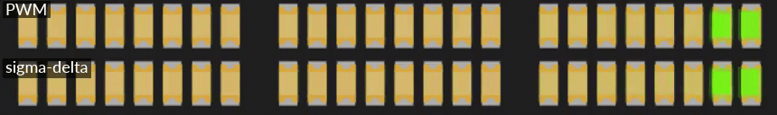
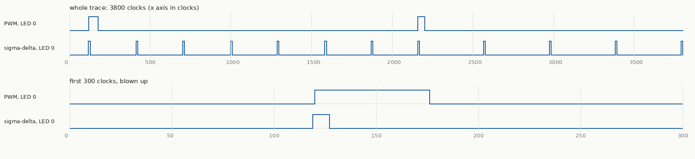

+++
date = '2026-10-19T01:00:00+11:00'
draft = true
title = 'RISC-V soft core 12: The scanner, third time'
author = 'Dean Sellers'
tags = [
    "riscv-cpu",
    "riscv",
    "fpga",
    "pwm",
    "interrupts",
    "peripherals",
    "hardware"
]
+++

# The scanner, third time

*Part 12 of the RISC-V soft core series. Previously: [Where it breaks]().*

The Larson scanner has been the series' test program from the start, and this is its third appearance.

In [part 1]() it was the blinkenlights: eight LEDs, one bit shifted along in assembly, and the only thing worth looking at was the CPU going FETCH, EXECUTE, FETCH. In [parts 6]() and [8]() it climbed the timing ladder: a delay loop, a polled deadline, then a timer interrupt with the CPU asleep in `wfi` between steps. The CPU stopped being the busy part.

This time it is the whole machine at once. Twenty four LEDs, a bright head with a tail that fades out behind it, written in C, driven by an interrupt, and the fading done by a peripheral I designed for the job.

## What I wanted

A head that glows, and a tail about six LEDs long that dies away smoothly. If the rumours are true the original Cylon eye or the K.I.T.T. grille was made using incandescent bulbs. A filament keeps glowing for a moment after the current stops, so the tail was free. An LED switches off instantly, so the afterglow has to be made.

Making it means controlling brightness, and an FPGA pin is either on or off. The usual answer is **PWM**: switch it on and off fast enough that the eye averages it. For 24 LEDs that is 24 PWM channels, and the question is who makes them. If the CPU does it by bit banging, it does nothing else. So the plan was two small peripherals, so that the CPU does almost nothing.

## Two peripherals

The first is a **general purpose timer/counter**. It counts, wraps at a value I choose, sets a flag and raises an interrupt. I already had a timer, `mtime`, but that one is the *system* timer and it counts real time. This one is an ordinary peripheral, so what it counts is a choice: the CPU clock, every clock, or edges on an external input. That choice matters later.

The second is a **LED dimmer bank**, and it is purpose built for the Io's 24 LEDs. It has one byte per LED. Write 255 to a byte and that LED is fully on, write 0 and it is off, and the hardware keeps doing it, every clock, with no CPU involved. A byte write sets one LED, a word write sets four.

That leaves the CPU a very small job. Once a frame, about a hundred times a second, an interrupt arrives and the handler does three things: fades every LED a little, moves the head every third frame, and stores the 24 bytes as six words. Then it goes back to sleep.

```c
static void __attribute__((interrupt("machine"))) frame_isr(void) {
    COUNTER_STATUS = 1;                       /* write 1 to clear, or it fires again at once */
    for (int i = 0; i < NLEDS; i++)
        level[i] -= level[i] >> DECAY_SHIFT;  /* afterglow: keep 7/8 per frame */
    if (++phase >= STEP_FRAMES) {
        phase = 0;
        level[pos] = 255;                     /* the head */
        pos += dir;
        if (pos == 0 || pos == NLEDS - 1) dir = -dir;
    }
    for (int w = 0; w < NLEDS / 4; w++) {
        const unsigned char *l = &level[4 * w];
        LEDS_DUTY[w] = (unsigned)gamma_lut[l[0]] | (unsigned)gamma_lut[l[1]] << 8 |
                       (unsigned)gamma_lut[l[2]] << 16 | (unsigned)gamma_lut[l[3]] << 24;
    }
}
```

The `interrupt("machine")` attribute is gcc's: it saves and restores what the handler touches and ends in `mret`, which is part 5 working in C. The `main` loop is `wfi` and nothing else. Writing the handler took no new CPU features, and it is the first time the traps, the timer, sleep and the compiler all work together in one program.

One detail that surprised me. Decaying brightness by shifting looks wrong, because the eye does not respond linearly: with a straight decay the tail looks like four LEDs of about equal brightness. The levels go through a gamma table (an exponent of 2.2) before they reach the dimmer, and the small levels map to zero, which also ends the tail cleanly.

## Same brightness, different waveform

The dimmer can make each LED two ways, chosen by a mode bit. **PWM** compares a counter with the brightness: on for the first part of each period, off for the rest. **Sigma-delta** keeps a running total per LED, adds the brightness every tick, and puts out a 1 whenever the total wraps. It spreads the same amount of on-time as evenly as it can, so at 50 percent it toggles every tick instead of making one long pulse.

I wanted a switch on the panel that flips between them while it runs, because the interesting part is that **you cannot see the difference**.



*The scanner in simulation, PWM on top and sigma-delta below. They are the same program and the same brightness bytes, and they look the same.*

The simulator's window only shows an LED's average, so it cannot tell them apart. The difference is in the waveform, so I added a trace to my simulator, `vsim --trace`, which writes the raw one bit signal of chosen LEDs to a file and prints a summary, and a small script, `vcd_png.py`, that draws those files as stacked waveforms. No waveform viewer needed, and it is the tool I will reach for every time I want a timing diagram from now on.



*Figure: one LED part way through its fade, in simulation. Both versions are on for exactly the same time, 96 clocks in this window. PWM does it in a single pulse per period and sigma-delta in short, evenly spaced ones.*

Over the same 4100 clock window the trace summary says it plainly: both are on for 96 clocks, the PWM waveform has 4 edges, and the sigma-delta one has 24.

That is also the price. Each edge costs a little, so a sigma-delta output switches many times more than PWM does. The dimmer's prescaler keeps it tame: one tick every eight clocks puts PWM at about 12 kHz and keeps sigma-delta edges at no more than about 1.6 MHz. No filter is needed on an LED. The eye is the filter, averaging over ten or twenty milliseconds.

### The off-by-one that both of them have

A textbook PWM counts 0 to 255 and is on while the count is below the brightness. Look at brightness 255: it is on for 255 of 256 counts, **never fully on**. The textbook sigma-delta, a modulo 256 accumulator, has the same fault for the same reason. I made the PWM count 0 to 254 (a period of 255) and the accumulator wrap at 255. Now both give *exactly* `duty` ones in every 255 ticks, so the tests can check exact counts instead of "about right". Owning the peripheral meant owning details like that.

## Three wrong turns

The strongest material was, as usual, what went wrong.

**The simulator passed a design that was wrong.** The first full build of the dimmer had Yosys warnings: "select out of bounds on signal sum" and "found logic loop". My first diagnosis was that a ten bit sum was spilling into the next channel's slot. I shrank it, and nothing changed. Editing the generated Verilog by hand narrowed it to an intermediate array of sums, written and read through the loop index. Without the array the warnings vanished. But Alchitry's own simulator had passed the design all along. A testbench on a simulator's model of my Lucid cannot see what the synthesiser makes of the same text. So there is now a script that runs Yosys's `check` and a Verilator testbench on the *generated* Verilog, and it fails on the old version.

**A deadlock that only the interactive simulator saw.** The first fader used the counter on its CPU clock source. But the fader sleeps in `wfi`, and while it sleeps the machine stops the CPU clock, so the counter froze and never raised the interrupt that would wake the CPU. In vsim the core got 212 clocks in a million and a half, and every LED was dark. All the lockstep tests passed, because they all run with the clock enable on, so none of them can sleep. The fix was to count every clock. A timer that stops when the CPU stops is *program time*, and a timer that has to wake the CPU cannot be program time. That is part 7's clock and wall time distinction again, this time biting a peripheral I had just designed.

**A reset that kept the last run's RAM.** I ran the fader, reset it twice, and the chase disappeared. It was not a race. The RAM is loaded once, by the bitstream, and a reset does not reload it, so a restarted C program began with the *previous* run's data. The fader had `static int dir = 1`. If the reset landed during the return sweep, `dir` was -1 at restart, the head started at LED 0 and walked backwards off the front of its array. I had assumed C's promise that `dir` is 1 when `main` starts. A normal microcontroller keeps it by copying initial values from flash on every reset. Here the RAM *is* the program store, so there is no second copy to copy from.

The first fix was to set the state in the function, and to make the build refuse any program with initialised data. The real fix was to make the start-up code keep the promise: it now appends a pristine copy of `.data` to the image and copies it back every start. Getting there turned up one more thing, found by reading the disassembly of the first program I built: the markers for the zeroing loop landed *before* the reserved copy, so in any program with `.bss` it would have wiped the copy. And the test, which restarts itself and counts passes in a CSR so that RAM is not involved, states its expected output outright, since the model and the hardware would happily agree on a broken start-up.

(A fourth, smaller one: the head moved about five times too slowly in the simulator, because a frame was a constant number of clocks and the simulator's clock stands in for 25 MHz. The frame now comes from the timer's timebase word, the same trick as the delay loops in part 6.)

## What it cost

All 24 channels in parallel, with both modes and a double buffer so that a write in the middle of a period cannot glitch a pulse, took the build to **6252 of 7680 logic cells, 81 percent**, with the timing report at 31.0 MHz against the 25 MHz the design is built for. The timer on its own took the design to 69 percent. So the dimmer is about a fifth of the chip, and it fits.

There were cheaper designs, and the cost is the point. Drop the double buffer and save about 190 cells. Make sigma-delta a build option instead of a mode bit and save about half. Rotate the 24 brightness bytes past a single comparator and it becomes about a third of the size, and then it is not parallel, so it is a different peripheral. The right answer depends on what this chip is short of, and on a bigger part, or one with PWM hardened into silicon, it would be a different answer again.

## What an FPGA gives and what it charges

This part is where the whole project's trade shows up in one program.

What you get is the computer your problem wants. A microcontroller has a fixed set of PWMs on fixed pins, and some of them share a timer so they must share a frequency. Here 24 channels is a number in a declaration, and sigma-delta was a handful of lines. It runs in true parallel with no jitter, because nothing is time-slicing it, and it costs the CPU nothing. And I could put the boundary between hardware and software wherever I liked: the afterglow is in C, and it could as easily have been a decay in each channel.

It is always about the speed, though, so here are the numbers. This core takes two to four clocks per instruction at a design speed of 25 MHz, which is around ten million instructions a second on a good day. An off the shelf Cortex-M0 is easily 25 MIPS, and the RP2040 manages 125 or more per core, with programmable I/O blocks beside the CPUs. Per dollar and per watt, the soft core loses badly.

But the problem sets the speed you need. A 25 MHz processor whose only job is to run a simple front panel, or talk SPI to another controller, is plenty, **as long as the peripherals do the real work**. That is what this program does: the CPU wakes a hundred times a second to move a few bytes, and the 24 channels do the rest. Slow is fine while the hardware is shaped to the problem. It stops being fine the moment the CPU has to do the work itself, which is what the cost table in [part 10]() showed for a multiply.

You also pay in engineering: this one program needed a unit test with mutants, a Yosys check of the generated Verilog, a model, a lockstep test and a simulator of my own, and the board would still have to confirm it.

So the honest summary is that an FPGA does not give you a fast computer. It gives you the *exact* one, and on a small part you pay for it in clock speed and in effort. Whether that is a good trade depends on how much of the work you can move out of the CPU and into the fabric.

## What I did not do

All of this is in simulation. The waveforms are the simulated pins, the timing report says what the build was made for, and I have not seen the LEDs on the real board. The brightness the eye sees depends on the real LEDs and the real pins, and the edge rates of sigma-delta on a board are exactly the kind of thing a simulator cannot tell me. If the board runs this, a scope on one LED in each mode is the picture to take.

## What I learned

The same program has now been a blinkenlight, a timed program and a system, and the machine under it grew each time. The most useful finding this round was not a feature. It was that three different tools each showed me something the others did not: Yosys saw the Verilog the simulator passed, vsim saw the deadlock that no test could reach, and the trace showed that two things that looked the same were not.

Next time, [the board arrives](): everything so far was simulation, and this is the first time it runs on the chip.
