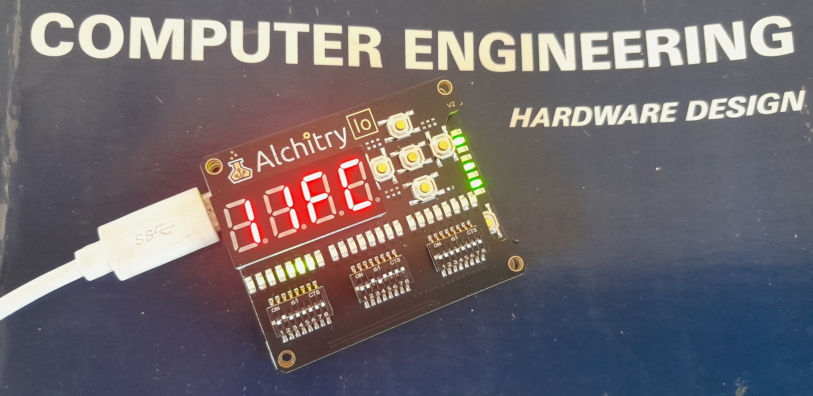
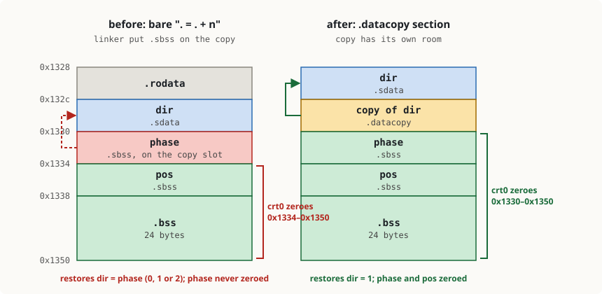

+++
date = '2026-10-23T14:00:00+11:00'
draft = false
title = 'RISC-V soft core 13: The board arrives'
description = "Switching on the soft core on a real FPGA board after twelve posts of simulation: dark LEDs, a silent serial port, and what the simulators missed."
author = 'Dean Sellers'
tags = [
    "riscv-cpu",
    "riscv",
    "fpga",
    "block-ram",
    "bringup",
    "hardware"
]
+++

# The board arrives

*Part 13 of the RISC-V soft core series. Previously: [The scanner, third time]().*

Twelve parts, and not one of them ran on a physical board. [It has been said outright](). The design had been built, placed, timing-checked and simulated three different ways, and never switched on. This part is the switching on. It did not go the way the simulators said it would, and the answer my friend was both software and hardware, perhaps the *greyware*.

*The board running [the ultimate Larson scanner](), in PWM mode at full speed, [with Mano for scale]().*

## Nothing

I flashed the build that had passed everything, with all the DIP switches down (boot menu entry 0, the plain Larson scanner), and waited for the lights.

The `alchitry load` said Done. The Io's LED bar was dark. The serial port was silent too, but menu 0 doesn't print, so that told me nothing.

(One small thing first: `alchitry load --ram` is refused on the Cu, "Lattice chips only support programming the Flash". So every test on this board is a flash write. That matters later, because a flash write reconfigures the chip.)

The obvious suspect was the hardware, says the [firmware]() guy: the Cu is a board with an Io board on top. I split them, checked that both were V2, reseated the Io with more care, power cycled, and the Larson ran. Written in the notebook that night: *a dead first power-up, make sure boards are seated*.

We all know where this is going ...

## The wrong menu

Of course it wasn't a connection issue. My sample size of one had coincided with a good boot. The hint I had ignored: the 7-segment display was up, so the Io was connected. What actually happened is that after a flash or a power-up the board sometimes booted into the wrong menu entry. With every DIP switch down, it ran the C demo, or the fader. Sometimes the first step press left the pc at 0000. Roughly half of the cold boots on one image, all of them on some other images.

**BUT** -  A press of the Cu reset button gave a good/expected boot, every time. I was pretty happy that my core pretty much worked at this point. Of course a machine that can't boot predicably is a *bit* of a problem, and I was now happy I opted for the Io add on. On real hardware I could stop and step, see the PC and watch the effect.

The investigation was a list of things that were not the cause, each one measured before being let go:

1. **The DIP pins floating.** I put the raw `io_dip[1]` pins and the synchroniser output on the LED bar. Both read 0.
2. **The table load.** The boot menu reads the switch register with an `lw` through a jump table. A probe on `x3` showed `0x37` after the load: the low byte of instruction 0, `lui x2, 0x80001000`. The load had read word 0 of RAM, as if `x2` were 0.
3. **`x2` never written.** A probe showed `x2` was 0 in a bad boot. Then a probe on the latched instruction: the first FETCH had latched a word that is not instruction 0. `0x023460`, `0x023450`, `0x100400`. None of them is a word in the image (I checked against the generated Verilog). Bits 1:0 were `00`, so illegal, so a trap back to pc 0. The garbage lasted exactly one FETCH.
4. **More reset edges.** Two to four. No effect.
5. **Hold reset for 5 ms after the PLL locks.** One good boot in one. That worked, and I reverted it anyway: an unexplained wait that *fixes* a bug will always bite you in the end.
6. **The reset conditioner releasing asynchronously.** Wrong, it is synchronous-release.
7. **A block select problem in the RAM.** The netlist says the sixteen `SB_RAM40_4K` are all configured the same, with no select mux.

What did the data say? A probe counting the clock enables seen while the cpu was held in reset: two, as designed. The read address at the last one: 0. The read register: 1. The RAM had been asked the right question twice, and the answer was still wrong. In one bad boot the low byte was `0x30` where it should have been `0x37`. Two of the four 2-bit RAM blocks that make up that byte lane returned the right bits and two returned zero.

The same bitstream gave the same junk on every boot, static, for ten seconds. Different builds gave different junk. Eight of eight hard power cycles of one image were bad, and a Cu reset was always good.

## To the datasheet

The Lattice memory usage guide (TN-02002) says that the block RAM's output register "is not automatically reset after configuration", so before the first valid read "the initial RDATA read value is undefined". So junk is documented. It does not say how long, or how many reads. The HX data sheet adds that "address 0 cannot be initialized", which is exactly the word my first FETCH reads, but I was running instruction 0 fine after a reset, so I took that as stale, or a mechanism I hadn't hit.

## The experiment decided it

So time to bisect the issue. The machine *logic* was pretty tested and since the datasheet and app notes made a point of the BRAM being different to the logic fabric at reset, I made a separate small project with one hand-instantiated `SB_RAM40_4K`, no Yosys inference, no CPU, no sequencer. It holds a preloaded pattern that is non-zero at every address, address 0 included, reads one address with the read enable always on, counts clocks from the first clock edge, and shows on the LEDs how many clocks it took for the output to equal the expected word.

- 25 MHz: **52 or 53 clocks**, ten power-ups out of ten, at every address I tried.
- 100 MHz: **204 clocks**, eight out of eight.

Fifty-two clocks at 25 MHz and 204 at 100 MHz are the same 2.0 to 2.1 microseconds. It is a time, not a number of clocks, and it is the same at every address, so the data sheet's note about address 0 might not be the full story. It seems like *any* address is undefined for two microseconds after *configuration*. In this case a cold boot is configuration, as the bitstream is read from flash at every boot.

Maybe it is a number of reads, or a time after read enable? Holding the read enable low until 5 µs and then reading matched the sentinel. There is no first-read ritual and no wake-up on the first enable. Seems like only a time window.

Two more facts that made the earlier mess make sense. A reflash does not clear the output register (it still held the previous image's last read), so a flash is not a cold start for this; only a power cycle is. And the Cu reset button never reconfigures the chip, so the window was long over. That is why a reset always worked and a power-up sometimes did not. The "junk" in my CPU probes was not the register's power-up value, it was the result of a read inside the window.

The reset logic at this point releases the CPU about four clocks after the PLL locks. That happens well before we have measured that the BRAM has settled.

## The fix

Hold the CPU in reset until a counter, started at the first clock edge, has run past the window with a margin. 2^8 clocks is 10.24 µs at 25 MHz: five times the measured figure.

***WHAT***, I hear you cry, but you already had the answer, just *WAIT*, and everything will be OK. Sure, but now we know more about why we have to wait, and when. And this patch may not be acceptable in a lot of situations. For instance we might need a setup time less than 11us. You could adapt the diagnositic code to wait on a sentinel read back, but what happens if that fails? In the real world, we're in risk assesment territory.

Bottom line on this implementation, a power-up now boots the right menu entry, sample size, more than one. Vendor confirmation of the BRAM setup time from configuration would be handy, but sometimes, you gets what you can measure.

## Then the reset button broke

Power-up worked. Then I pressed the Cu reset on the fading Larson, and got random results. A normal sweep, the head flying off one end, no scan, or stuck on the first LED. A power-up always worked. Menu 0, shifting and reversing x1, on a reset was fine.

I blamed the new start-up hold first. It is inert after 256 clocks, and the same fader failed on main, which doesn't have it. Then the register file, which isn't the problem (and the Larson reloads `x1` with `jal` every pass). Then warm starts in general. In vsim the C demo printed identical text with identical cycle counts after a mid-run reset, so it wasn't the CPU.

The step that worked was a snapshot of the LED strip at the same moment after a cold start and after a reset at 0.2 s. Cold: one head with a tail. Warm: every other LED lit, no sweep. Deterministic, so reproducible, so findable. That was in simulation: **the bug was in software, and I could reproduce it without the board.**

[Part 12]() had fixed one start-up problem already: a reset doesn't reload the RAM, so a restarted program finds the last run's data, and `crt0` now restores initialised data from a pristine copy on every start. This was the second half of the same problem, and it was the linker script telling two different stories about where "after the copy" is.

The script reserved room for the copy with a bare `. = . + n` between two output sections, then set `_bss_start = .;` and placed `.sbss` with `> RAM`. The location counter `.` did move, so `_bss_start` was right: after the copy. But a section placed in a memory region goes where the *region's* fill pointer is, the end of the last section placed there, and an assignment outside any section never moves it. So `.sbss` went to `_edata`, on top of the copy. Part 12's version of this bug was a marker symbol in the wrong place; this one was a symbol and a section disagreeing.

*The same words of RAM, before and after*

So the "pristine" copy of `dir` (the direction the head moves, 1 or −1) was the live frame counter `phase`, which is 0, 1 or 2. The start-up code restored `dir = phase`. 1 sweeps fine. 0 never moves. 2 moves two LEDs at a time and skips `pos == 0 || pos == 23`, so the head runs off the end. A power-up always worked because the image has the real 1 in that slot.

The zeroing loop covered 0x1334 to 0x1350, so it never cleared `phase`, which sat just below it. The fix gives the room a real output section (`.datacopy`, `NOLOAD`), which does move the region pointer, and `cbuild.py` now refuses to produce an image where any section overlaps the copy or where `.sbss`/`.bss` lie outside the zeroed range. It fails on the old script. The lockstep test of the same program had the same overlap, but it never pressed reset, which is why nothing caught it.

I flashed a build with both fixes. All the demos, the fader in both modes, cold starts and warm resets, and the serial port at 1 Mbaud seem to work.

## What the board said that the simulators couldn't

- The cold start has a time in it. No simulator had a model of the block RAM's first two microseconds: Alchitry's RAM is a Lucid model, vsim and xsim run the Verilog, and none of them has an output register that is undefined for a while after power-up. Part 11's list of "where it breaks" was a list of what the simulators could find. This one only the chip could.
- The bug I assumed was hardware was software. The bug I assumed was software, was hardware. Both were reproducible once I stopped guessing: the second in vsim as soon as I compared a cold start with a warm one at the same time stamp, the first on the chip as soon as I took the CPU out of the experiment.
- "It worked after I reseated it" is a data point, not a diagnosis.



## Still to do

The things only the board can tell me are still a list in the bring-up notes, and they are the next post, with a proper scope this time:

- **The real clock rate.** The cpu-clock LED toggles on every cpu clock, and at slow that is 25 MHz / 2^20 = 23.8 clocks a second, so it should blink at 11.9 Hz. A pocket scope gave 83.2 ms a blink against 83.9 expected, but I want a decent capture, and then timing shots of the 25 MHz clock itself.
- **Does it meet 25 MHz?** nextpnr checks every flop-to-flop path in a clock domain, but it prints only the worst one, ignores paths it was not given constraints for (the asynchronous switches and buttons, the crossings to the 100 MHz domain), and its answer moves with the placement seed: the same logic has built anywhere from 28 to 34 MHz. 28.5 against 25 is a small margin, and a timing report says nothing about this chip at this temperature. I can't prove it, but I can bound it: read the whole report, build with several seeds, then run a self-checking workload on a faster PLL until it breaks, warm and cold, to measure the margin instead of assuming it.
- **The doubled serial byte.** The Alchitry simulator sometimes sends a byte twice because its flip-flops in different instances don't update together. The chip's do, and the Yosys simulation never shows it, so I expect it never happens for real. The test is a long log of the hello demo's numbered lines (a doubled or dropped byte shows as a bad line) and a diff of paced bytes through the echo loop. Zero errors in N bytes only bounds the real rate, at about 3/N with 95% confidence, but that is enough to say it is not the same bug.
- Button bounce through the debouncers, the 7-segment flicker, and the sleep light on a scope.

Next time, [measuring the board](), with a proper scope.
