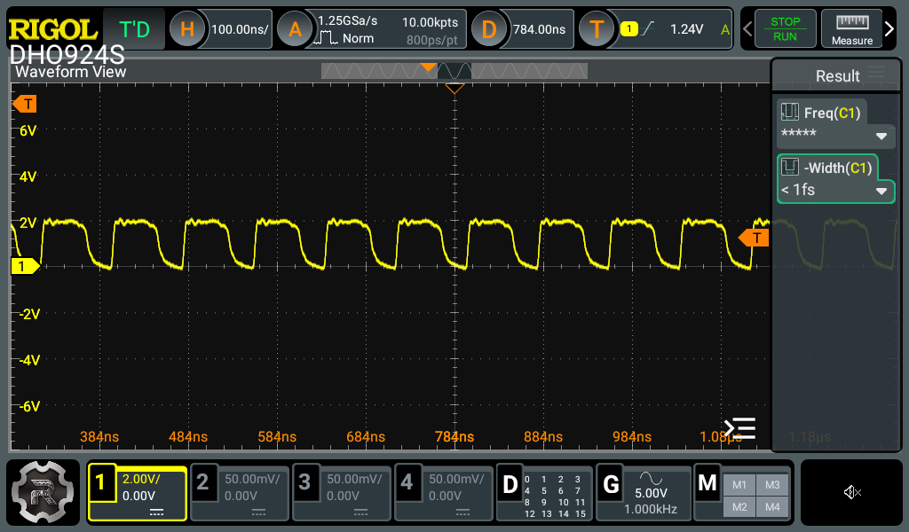
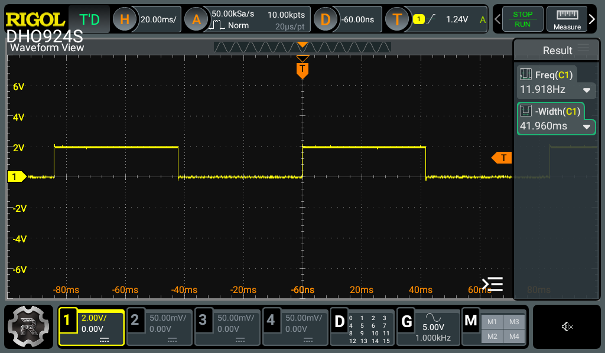
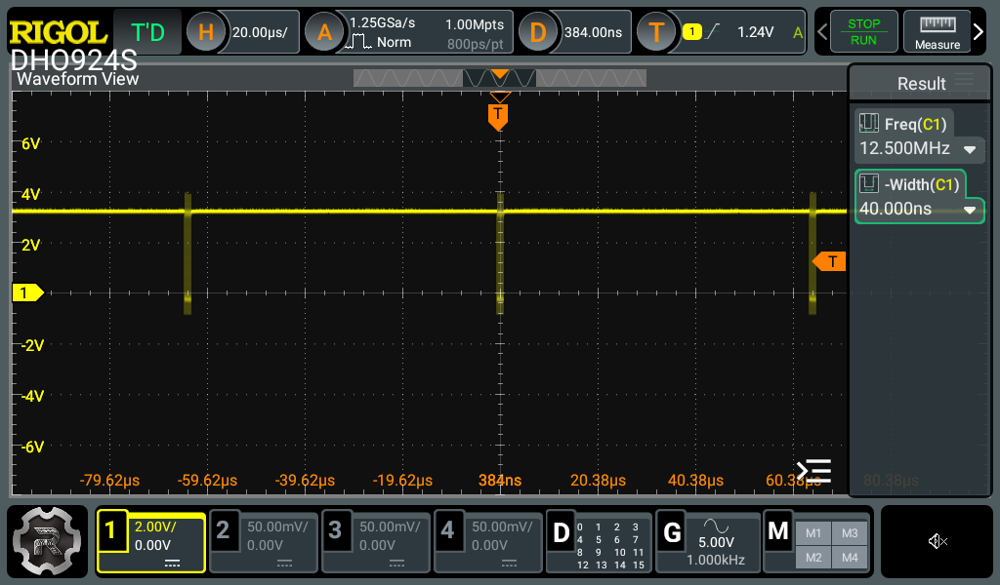
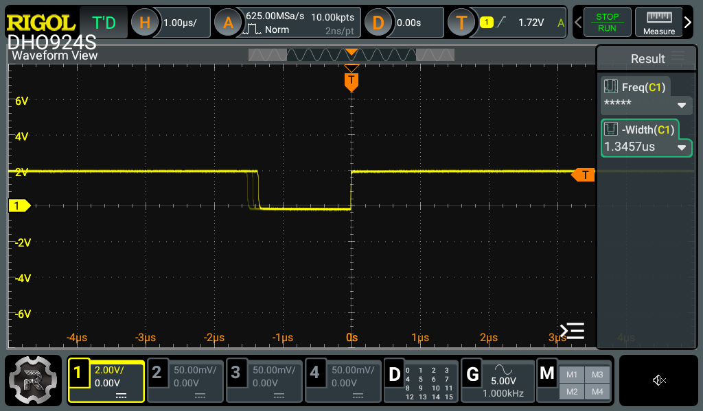
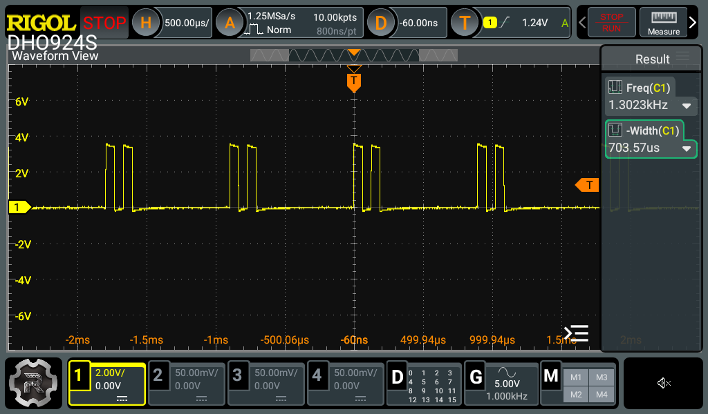
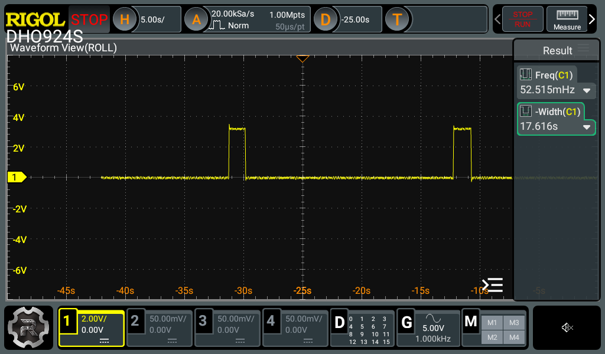
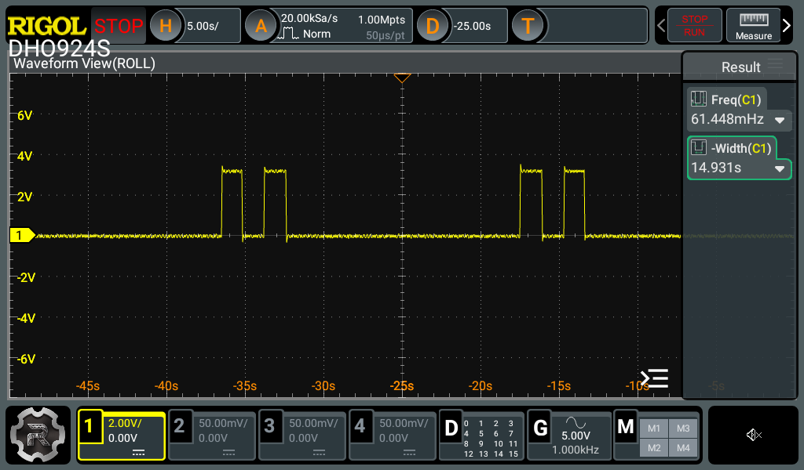

+++
date = '2026-10-27T14:00:00+11:00'
draft = false
title = 'RISC-V soft core 14: Measuring the board'
description = "Measuring the soft core on a real Alchitry board with a scope and serial soaks: the 25 MHz clock, timing and what the simulators got right."
author = 'Dean Sellers'
tags = [
    "riscv-cpu",
    "riscv",
    "fpga",
    "oscilloscope",
    "uart",
    "hardware"
]
+++

# Measuring the board

*Part 14 of the RISC-V soft core series. Previously: [The board arrives]().*

Part 13 ended with a list of things only the board can tell me. This part is the list I could get to: a scope on three signals, and a lot of bytes down the serial port. This might be the first part with no surprises, or a bunch of *that's what I thought* bits.

I'll say up front what is *not* here. I haven't shown that the core meets 25 MHz on every path, and I haven't looked at button bounce or the 7-segment flicker. Those are still to do, and maybe I will. This isn't going to production, and with the signals I scoped and the serial soaks behind me I am fairly confident that what is supposed to happen is happening. As we know though ... there are always edges.

## The clock

The Cu has an LED that toggles once per cpu clock, so it shows half the clock rate. At full speed the cpu clock is 25 MHz, so the LED should run at 12.5 MHz, a period of 80 ns. Here it is on a Rigol DSO:



*The cpu-clock LED (Cu LED 4), full speed.*

That tells me two things. The PLL is making something like 25 MHz. And the clock enable fires on every clock at full speed, so none are skipped. It does not tell me the logic is fast enough for that clock. Timing is a separate question and this isn't the answer.

The edges are rounded and the top is at about 2 V, not 3.3 V. That is my probe point: I was on the LED side of its series resistor, so I'm looking at the LED's forward drop, with the LED and the probe loading the edge. Moving upstream to the pin side gives the real signal:


*The same clock at the pin: 3.3 V swing, a low of 39.5 ns, ringing and about 1 V of undershoot. This is the shot if I ever want an edge rate.*

With good edges the scope reads 12.500 MHz. At slow the cpu clock is 25 MHz / 2^20 = 23.84 clocks a second, so the LED should blink at 11.92 Hz:



*Slow mode, 20 ms/div. Scope measurement: 11.918 Hz, low for 41.96 ms. Expected 11.921 Hz.*

Two other captures read 11.920 Hz. The pocket scope in part 13 said 83.2 ms a blink against 83.9 expected; this says 83.9, so the pocket scope is not completely terrible.

## Sleeping

[The sleeping post]() gave the core a real `wfi`. When the cpu waits for an interrupt with nothing pending, the machine stops the cpu clock, and the cpu-clock LED freezes. The boot menu's timer-interrupt rung (entry 5) sits in `wfi` between ticks, so it is a good place to see it. The same capture at 20 µs/div:



*The cpu-clock LED over 160 µs. The line sits high, frozen, and the bursts are the core waking: each one is a handful of 12.5 MHz clocks. They are about 60 µs apart by eye against the 64 µs tick the program asks for.*

Cu LED 6 is the asleep light, and shows how long each wake lasts:



*LED 6, triggered on the rising edge (back to sleep). The line is high while asleep, and goes low for 1.35 µs: about 34 cpu clocks at 25 MHz for the whole tick.*

The falling (wake) edge is not in one place; it shows up in three positions a couple of clocks apart. So the awake time takes three different values. I guessed three paths through the handler, and the code agrees. This is the whole handler (`larson_tick`), one step per interrupt:

```
larson_tick:
    beq   x13, x0, tick_right     # direction
    slli  x1, x1, 1               # step left
    addi  x4, x0, 0x80
    bne   x1, x4, rearm           # not at the end: 4 instructions to here
    addi  x13, x0, 0              # at the end: turn round...
    jal   x0, rearm               # ...and jump, 6 instructions
tick_right:
    srli  x1, x1, 1               # step right
    addi  x4, x0, 1
    bne   x1, x4, rearm           # 4 instructions
    addi  x13, x0, 1              # turn round, then fall through: 5 instructions
rearm:                            # mtimecmp += period (64-bit), the same on every path
    ...
    mret
```

Every instruction that isn't a load or store takes two clocks on this core. A step in the middle of the sweep is four instructions in either direction. Turning round at the right-hand end takes one more, and turning round at the left-hand end takes two more (the extra `jal`). So the awake time is 34, 36 or 38 clocks, which is 1.36, 1.44 or 1.52 µs, and the ghost edges are 2 and 4 clocks apart, 80 and 160 ns. The picture has them about 70 to 100 ns apart. The shots read 1.35 µs and 1.43 µs on their last trigger, which are the 34 and 36 clocks. I didn't capture the 38. The total is my count of the trap entry, the handler, `rearm` (two `lw`, two `sw`, three ALU instructions), `mret`, the `jal` back to `wfi` and its fetch, and I took `mret` as two clocks without checking it against the core. And really, you can't argue with the 'scope.

## The Larson scanner, in real time

With the same program running at the same time, an Io LED shows the scanner's head passing. At full speed the pulses are tiny:



*One Io LED, full speed, 500 µs/div. A pair of pulses per sweep, a step of dark between them: one going out, one coming back.*

It does look a bit like a PWM signal but it's the sweep itself. Each pulse is one step, about 64 µs wide. A sweep of 14 steps takes about 0.9 ms, and the LED is lit once on the way out and once on the way back, with a dark step between. To your eye it's a steady glow along the row, so kind of PWM, but the glow is even along the row and isn't hanging in one spot.

At slow, the same thing is visible by eye and the scope can see the steps:





*LED 0 (the end) and LED 1, slow, 5 s/div. LED 0 lights once per sweep. LED 1 lights twice, with a step of dark between them: the head passes it, reaches the end, and passes it again.*

A step is about 1.35 s at slow and a sweep is 19.0 s (scope: 52.5 mHz), so 14 steps are 453 cpu clocks at 23.84 Hz: about 32 clocks a step. At slow the handler overloads (the next tick is already due when `mret` returns), so a step is just the handler plus the trip round the loop, and my count above gives about 34. So the count is within about two clocks of the scope, and I could go looking for why, later.

## Serial: does the doubled byte happen?

The Alchitry simulator sometimes sends a UART byte twice, because the flip-flops in different instances don't update together. The chip's do. The test is on the real board. The scripts (`serial_soak.py`, `serial_echo_soak.py` and `serial_edges.py`) are in the [RISCitry repository](https://github.com/d-o/RISCitry) under `tools/`.

**The transmitter.** The hello demo prints a numbered line (`sweep XXXXXXXX`) per scanner sweep, so every byte of the stream is predictable. A host script read it for ten hours at full speed: 3.57 GB, 223 million lines, and checked every line against the pattern and the counter. Zero doubled, dropped or corrupt bytes, and no resets. Zero errors in N bytes only bounds the rate, at about 3/N with 95% confidence: below 8.4 × 10⁻¹⁰ per byte.

**The receiver.** The C demo (menu 7) echoes every byte raw. The host sent random chunks from 1 to 128 bytes and compared each echo byte for byte: 40 million bytes over seven hours, zero faults at any chunk size. That includes 20 MB of back-to-back 128-byte bursts.

So the doubled byte from the Alchitry simulator has not happened on the chip. That is not proof that it can't, and the bound is only as good as the test.

The one thing that did go wrong came from a longer burst. Edge probes (every byte value, bit patterns like 0x00 and 0xAA, 120 s idle gaps, 1 to 100 ms breaks) all passed. A burst longer than about 350 bytes at line rate, though, loses bytes: from 1 KB to 64 KB, every run, and 0.8% of bytes after the first loss. The ones that survive are intact and in order.

That is a throughput limit, not a corrupt byte, and it isn't **wrong**, we just observed one of the famed edges. The echo loop sends bytes about 80 ns slower per byte than they arrive (0.8% of the 10 µs a byte takes at 1 Mbaud), so the one-byte receive buffer overflows once the three bytes of slack are used up. Three bytes at 0.8% is about 375 bytes, and the measured first drop is at 351. I haven't measured the 80 ns on the pin: I can't tell from the host whether it belongs to the C loop or the transmitter's hand-off. A scope on `usb_tx` would show the gap between echoed bytes. On the Cu the serial is an FTDI transceiver and there isn't a good point to probe. I could probably point the serialiser at a different pin and scope it, but ...

## What slow mode found

At slow (a cpu clock of 24 Hz) the receiver takes a byte every 1.5 s and the second byte of a pair is always dropped: that is the one-byte buffer doing its job, a byte arriving while one is unread is dropped and flagged as overrun. And the C demo takes about 67 minutes from reset to its `type:` prompt.

The part I didn't expect was the clocks-per-call table. The same table printed at slow and at full speed, and the slow one was wrong for the big operands. Each figure over 256 clocks a call was short by exactly 256 or 512. The core was right. The C was wrong: `report()` computes `t * TIMEBASE` in 32 bits before dividing by the run count, and the product wraps. It had always been wrong; at full speed the times are small enough to fit. Slow mode turned it into a big number. (A residue of about two clocks a call on one row is unexplained.)

## Still to do

- **Does it meet 25 MHz?** Everything above says the clock runs, and the logic worked at that clock for the tests I ran. It doesn't bound the margin. That wants the whole nextpnr report, several seeds, and a faster PLL until something breaks.
- **The gap between echoed bytes**, on the scope at `usb_tx`.
- **Button bounce**, the **7-segment flicker**, and a **wake from a button press or a serial byte**, all the sleep shots here are timer wakes.

## Wrapping it up

While there are things I could do to keep characterising this, it isn't a production grade exercise, and I want to move on to something more interesting. To me anyway; most people I know wiuld be bored to the back teeth long before getting this far. So for now that is as far as I have got, I have learned and remembered a load of stuff that was sitting in long term storage. One of the big take homes is that the fundamentals haven't changed at all. What has changed is the tooling, all of this was done for free (as in beer) except for a reasonable spend in hardware. On that note the [Alchitry](https://alchitry.com) Cu and Io boards are great, huge props to that team. I will be looking into the other more capable boards in their ecosystem when I need to.

So, what is the thing that interests me now? I can think of two ways I could take this, and I will probably get to both eventually. The first (and the ultimate Larson gives a clue) is to go all analogue, so a sigma delta DAC and ADC. The DAC is easy, in fact I have done it. The companion ADC needs a comparator though, and the iCE40 based Cu doesn't provide a built in one. So a small Alchitry *element* board with a filter and buffer for the DAC and a comparator and loop filter for the ADC. Of course the performance won't be great in modern terms, but certainly usable, if you know the limits. This project appeals as I haven't done much board design and fab and that muscle needs exercising.

The second might be a bit ambitious, but it might be interesting to see if this core could run [Zephyr](https://zephyrproject.org). I would need to define a SoC and board and see what else is missing. We have the system timer, our simple interrupt controller might not work, the ISA support might also be lacking. The elephant in the room would be RAM I suspect, there are still unused blocks though. This idea is probably less well formed and lower on the list, but it might be a fun exercise. I imagine there is quite a bit to find out about both Zephyr and our RISC-V core. I am not imagining a world where I would need a soft core like this to host an RTOS, but it's the thought that counts!

But for now, if you made it this far, well done. I'll try my best to get the next steps up and going soon!
