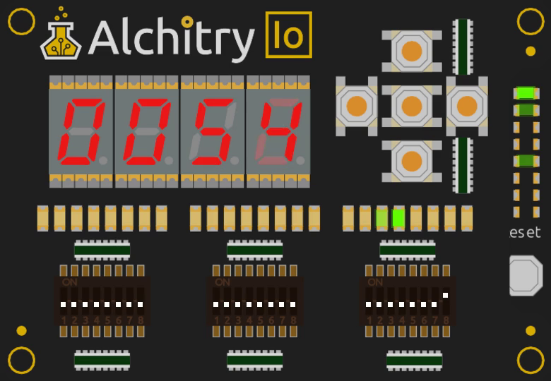

+++
date = '2026-10-18T17:00:00+11:00'
draft = true
title = 'Simulator 0: The simulator I use'
author = 'Dean Sellers'
tags = [
    "riscv-cpu-sim",
    "verilator",
    "simulation",
    "fpga",
    "hardware"
]
+++

# The simulator I use, with the lid off

*Part 0 of a second thread alongside the RISC-V soft core series. It runs in parallel: the CPU posts say what the machine does, these say how I watch it.*

*Series: [RISC-V soft core]() and [Simulator](). Part 0 of the simulator thread, so no previous part. The first CPU post is [A CPU you can watch]().*

The RISC-V posts show a lot of pictures of an FPGA board. None of them are the board yet. They are a simulator, and since I keep leaning on it I should say what it is, what is mine, and what is not.

## Why not the one that came with the tools

Alchitry Labs has a simulator built in, and for small designs it is fine. For a CPU I kept running into two things. It is slow, a few hundred clocks a second, which is hopeless when a program needs a million of them to print a line. And, again when you start to do things like make a microprocessor system, it's simulation method races. Both get their own post. For now the short version is that I wanted a second simulator I could trust more and run faster.

## What it is

[Verilator][verilator] is an open source tool that turns Verilog into a fast C++ model. The Alchitry tools already write Verilog for the FPGA build, so I point Verilator at exactly that, the same files that go to the chip. A small C++ program around it, which I call `vsim`, does the rest: it feeds the model a clock, reads the pins back and draws the board.



*The window while the Larson scanner runs. Four seven segment digits show the program counter, the row of LEDs just above the right hand switches shows register x1, and the Cu's own LEDs are in the column on the right.*

## What is mine and what is not

None of the picture is mine. The artwork and the layout of the [Alchitry Cu][cu] and [Io][io] boards, where every LED, switch, button and digit sits, come from the open source [Alchitry Labs][labs] (GPL-3.0). `vsim` reads the images out of my installed copy when it starts and draws them, so none of their files are in my project. The simulating is Verilator's. What I wrote is the glue between the two: the clock and reset, the switches and buttons you click, the serial port, recording and scripting.

If you want the real thing, go to Alchitry. It is a very nice set of tools.

## Why bother

Four things made it worth the effort:

- **It runs the design's own Verilog.** The design is what gets built, not a model of it. All the flip flops update together, as in silicon, and the main memory is the real block RAM description.
- **It is quick.** Several million clocks a second, against a few hundred in the IDE. I can run a whole program in the time it takes to look up.
- **It runs at the board's pace.** The board design runs the CPU slowly so you can watch it, and timers and debouncers count in real time. I scaled the simulated time so the slow mode, the timer demos and the buttons *feel* like the board should, then throttled it to match. There is a switch to build it with the exact values the board build uses, which runs at about a fifth of real speed.
- **I can drive it.** You can click the switches and buttons with the mouse, and the serial output goes to the terminal and to a pseudo terminal you can attach `picocom` to.

## Scripting it

The part I use most is the window. One of the reasons the sim has been refined is I work in real time, I like to see the tools be real time, or at least honest to their timing.

`vsim` can run with no window at all though, the examples throughout were probably captured in a headless mode. In headless it is possible to press buttons at exact clock counts, type text at the serial port and save a picture or a video. For example, the C demo from a later post:

```text
vsim --dips 400700 --headless 0.2s
```

That sets the switches, runs two tenths of a board second and prints what came out of the serial port. The video in the first CPU post is one command too, `--record`, and it is repeatable, because every frame is exactly one frame of board time whatever the speed of the computer that made it.

Scripted clicks turned out to matter. They confirmed what I had seen clicking by hand, and slow mode shows it up best. When pressing a button quickly only printed the first press, I did not have to guess (see [Time and interrupts]()): I scheduled five presses 150 ms apart and counted what came back. Then I tried 20 ms presses and got nothing at all, which is the debouncer doing exactly what it should.

## What it is not

It is a simulator, so it knows nothing about the pins, the timing of the real chip or a loose wire. The serial port runs five times slower in wall time than the board's, which is 1 Mbaud. And it only simulates the Verilog that the build writes, so I have to run a build first and it warns me when the files are stale.

It is also still one tool. The posts to come include the ways two simulators can disagree, and the day this one found a bug the other one could not see: a timer that would have ticked 25 times too fast on the real board.

Next in this thread: [why the IDE simulates at 284 Hz](). The machine thread carries on with [A CPU you can watch]().

## References

- Verilator: <https://www.veripool.org/verilator/>
- Alchitry Cu: <https://alchitry.com/boards/cu/>
- Alchitry Io: <https://alchitry.com/boards/io/>
- Alchitry Labs V2 (source, GPL-3.0): <https://github.com/alchitry/Alchitry-Labs-V2>

[verilator]: https://www.veripool.org/verilator/
[cu]: https://alchitry.com/boards/cu/
[io]: https://alchitry.com/boards/io/
[labs]: https://github.com/alchitry/Alchitry-Labs-V2
