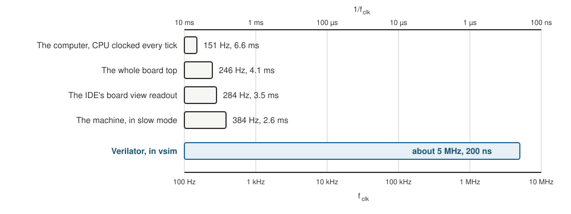

+++
date = '2026-10-18T20:00:00+11:00'
draft = false
title = 'Simulator 1: Why the IDE simulates at 284 Hz'
author = 'Dean Sellers'
tags = [
    "riscv-cpu-sim",
    "simulation",
    "performance",
    "fpga",
    "hardware"
]
+++

# 284 clocks a second, and the wrong place to look

*Part 1 of the simulator thread. Previously: [The simulator I use](). The other thread is the [RISC-V soft core]() series.*

The IDE's board view has a little readout in the corner. It said **Running at 284 Hz**, in red, because it wanted 1 kHz and could not get there. The board's clock was 100 MHz, so the simulator was running the design more than three hundred thousand times slower than the real thing, and the Larson scanner crawled across the LEDs.

I assumed the fault was mine. The design had been growing, and I suspected it was thrashing the simulator.

## The first guess, and why the test could not see it

The suspect was the data RAM. Its simulation model was an array of flip flops, and arrays are expensive to simulate. So I timed it, running the machine with Larson from the command line:

- the design as it stood: 362 clocks a second,
- with the data RAM cut from 256 words to 4: 365,
- the version from before the last big change: 376.

No difference. So the RAM was innocent, and I was ready to move on.

Except that those runs were in the board's **slow mode**, where the CPU only ticks once every 128 board clocks. For most of those 3,000 clocks the CPU was doing nothing, so a measurement that depended on CPU activity could never have seen it. The test was blind to the thing I was asking about, which is the same problem as part 2 in a different place: a measurement that cannot tell you the answer is not an answer.

## Measuring properly

I ran the same 3,000 clocks against pieces of the design, one at a time:

| What was simulated | Clocks a second | Time per clock |
|---|---|---|
| The machine, in slow mode | 384 | 2.6 ms |
| The whole board top | 246 | 4.1 ms |
| The computer, with the CPU clocked every tick | 151 | 6.6 ms |
| The same, with a 4 word RAM | 173 | 5.8 ms |

Three things came out of it.

- **Even an idle design costs 2.6 ms a clock.** The simulator re-evaluates the whole design on every step, whether or not anything changes.
- **The board's extras add real time.** The display, the debouncers and the LED multiplexing add about 1.5 ms.
- **The RAM model is about 13 percent of the CPU's cost.** It was a minor player after all. A seven program ROM cost nothing I could measure.

And one result I did not expect: **"fast" mode is slower than slow mode**. In fast mode the CPU ticks on every clock, so the simulator does the expensive work on every clock. That is not a fault. It is what the numbers say.

## What the simulator is doing

I read it this way: the Alchitry simulator is an interpreter. It runs the Lucid description step by step, evaluating the whole design, about 3,500 logic cells' worth, again for each clock. There is no combinational loop, which would have been an error and not a slowdown. It is just a lot of work per step, and each CPU clock edge adds several milliseconds on top. That is why the readout dips and wobbles.

It says nothing about the hardware. The 284 Hz belongs to the simulator and not to the design.

## The fix that is not a fix

What I could do was change what a clock means in the simulation. In the board view the design was using a slow mode with a half period of 128 board clocks. I cut the simulated one to 8. The simulator ran at exactly the same rate, but Larson went from about half an instruction a second to about nine, which you can actually watch. The real hardware keeps its own, much larger, setting.

This is a trick, and it is a trick of the display. It does not make the simulator faster. It makes the same slow simulator more useful.

## Later, the same wall from the other side

The clock rate was not the only cost. As far as I can tell, every `$tick()` in a testbench makes the simulator keep a snapshot of the whole design so the waveform view can show it. With a few thousand ticks, and a RAM model of 2,048 words, that exhausts the memory the simulator is given.

I first took one of these for a hang: a mutated test sat at about twelve hundred percent CPU for eight hours before I came back to the loop and wondered why it hadn't finished. The log was full of `OutOfMemoryError`. The JVM had been thrashing against its heap limit, not deadlocking. The cure for the long printing tests was `$silent_tick()`, which does not keep the snapshot, and a watchdog on time and memory for every suite. But really I was pushing an interpreter, a BASIC style sim, past what it could sustain, and `$silent_tick()` would only buy so much time.

## The way out

None of that was fixable from my side, so I stopped trying. The design was not the cause. The tool was a slow interpreter with a wall at its memory limit, so I needed a different tool, and that is what [the simulator I use]() is for.

| | Clocks a second | Where the time goes |
|---|---|---|
| The IDE's simulator | about 300 | interpreting the design, and a snapshot per tick |
| Verilator in `vsim` | about 5 to 7 million | compiled C++ |

*Simulated clock rate on a log scale, as a frequency along the bottom and as a period along the top. The four short bars are the Alchitry Labs simulator, measured as in the table above, and the readout in the board view. The long one is Verilator running the same design.*

That is roughly twenty thousand times faster, on the same design. It means I can run a whole program in the time it takes to look up, and run it at the pace the board will, slow when I want to see it, fast when I do not.

## What I learned

Two things, both about measuring:

1. **Check that your test can see what you are measuring.** A timing taken while the CPU was asleep could not see CPU cost. If I had asked "what would this experiment show if I were right?" before I ran it, I would have caught that.
2. **Find out what the tool is doing before you blame the design.** I suspected my own RAM, when the answer was that the simulator is an interpreter, and a slow one.

Next in this thread: [a simulator that lies]().
