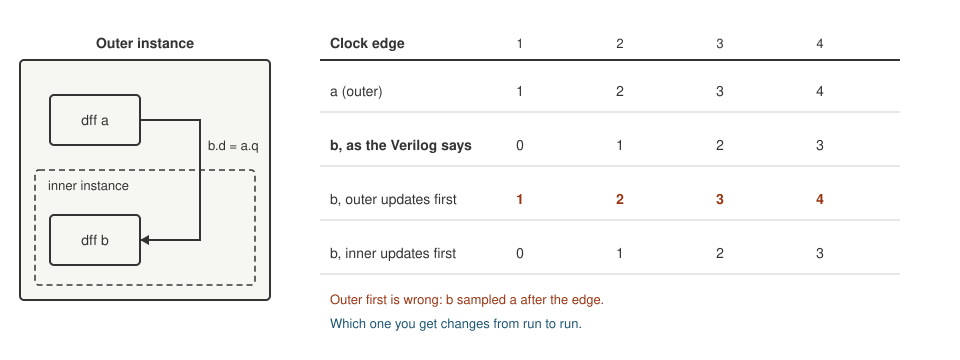

+++
date = '2026-10-18T21:00:00+11:00'
draft = false
title = 'Simulator 2: A simulator that lies'
description = "A mutation test that failed when my reasoning said it should pass, and the simulator that reported loads writing nothing to the register file."
author = 'Dean Sellers'
tags = [
    "riscv-cpu-sim",
    "simulation",
    "verification",
    "fpga",
    "hardware"
]
+++

# A simulator that lies, and a mutation that should not have failed

*Part 2 of the simulator thread. Previously: [Why the IDE simulates at 284 Hz](). The other thread is the [RISC-V soft core]() series.*

In [part 2 of the CPU series]() I said to break your design on purpose and watch the right test fail. This is the story of a break where the test failed and my reasoning said it should not have.

The change was small. In the CPU, the register that holds the current instruction, `if_id_reg`, only takes a new value at the end of FETCH. I made it take one on *every* clock. My hand trace said that was harmless. Every other clock re-reads the same address, so it would just latch the same word again. The only exception is the end of WRITEBACK, where the word on the bus is the loaded data and not an instruction, but that is the last clock of the instruction, and FETCH then latches the real next one.

The simulator said loads wrote nothing.

## A probe, and a puzzle

I routed the instruction register out on the debug output and looked. It showed the right instructions and the right load data, `0x80817F01` for the first byte load of a test program. And yet register `x4` stayed 0.

So the data was right and the write was not happening. That is not what my trace predicted. One of the two was wrong.

## The simplest thing that shows it

I took the CPU out of it. Two modules: an outer one with a flip flop `a` that counts, and an inner one whose flip flop `b` copies `a`.

In real hardware both flip flops sample on the same edge, so `b` is always one behind `a`. In the Alchitry simulator, `b` came out equal to `a`.

*Three versions of `b`: what the Verilog says, and what the simulator gives depending on which instance it happens to update first.*

The simulator updates the flip flops one instance at a time, and each update is visible to the ones after it. If the outer instance goes first, the inner flip flop samples the *new* value of `a`, from after the edge. Flip flops in the *same* module were always fine. It is only across instances that the order shows.

That is exactly what happened in the CPU. `if_id_reg` lives at the CPU level and the register file is a separate instance. When `if_id_reg` updated first, the register file saw the load data as the instruction, decoded it as illegal, and quietly dropped the write. By the rules of the Verilog, which is what a chip would be built from, the mutation should be harmless. I can only say "should" for now, because nothing here has run on a chip.

## The wrong theory

It got stranger. Add two unrelated flip flops to the outer module and the repro came right. Rename `a` to `zz` or `q` and it came right. Rename the instance and it broke again.

So I theorised that the order depended on names. Alphabetical, roughly, with exceptions. I wrote it down and told myself I understood it.

Later the same day I did what I should have done first. I ran the *unchanged* repro eight times. It came out right twice and wrong six times. The order is not set by the names. It changes from run to run, probably something to do with how the JVM orders objects. The "renaming" results had each been run once, and they were coin flips that I had taken for a pattern.

It is the lesson from [part 1 of this thread]() from the other side. A measurement taken once is not a measurement.

## Every result is a sample

The consequence is awkward. If the Alchitry simulator's flip flop order is random, then:

- **A pass does not prove the timing.** The run may have gone in a lucky order.
- **A failure may be an artefact.** The `if_id_reg` mutation "failure" was exactly that.
- **The main evidence that the core works is a sample**, not a verdict.

My most important test suite, the one that runs real programs on the core and compares them with the model, had been running on a simulator that could not be fully trusted.

## It bit again, in the UART

It did not stay theoretical. A UART test failed about one run in four to eight, always with the same symptom. The second byte came out as `H` again where an `i` was wanted. A longer printing test, `STRING`, sixteen bytes, failed more often than not: a byte dropped here, a byte sent twice there.

A test that usually fails is worse than none. It trains you to ignore it.

I chased it properly this time. I timestamped every byte the testbench received, and the duplicate arrived 81 clocks after the original, exactly one byte time. So it was real on the line. Then I logged every clock the CPU spent in MEM_ACCESS at the store that sends a character: `0d`, `0a`, `48`, `65`, each exactly once and correct. The CPU's stores were right. The line carried `0d`, `0a`, `0a`: the `H` never went out and the old byte was sent again.

So it was inside the UART, at the hand-over between its two clocks, and only in this simulator. The Yosys simulation of the same Verilog passed every time.

## Fix the design, not the simulator

I could not fix the simulator. What I could do was make the design not care about the order.

The UART's decision to accept a byte depended on a signal from a child instance, `busy`, and the child's decision depended on a signal from the UART. Each read the other's value from either before or after the edge, depending on the order, so one order dropped the byte and the other sent it twice. Both symptoms were seen.

The fix was to make the decision depend only on the UART's *own* state, and to hold the strobe for two clocks, so it does not matter on which edge the child looks. It cost two flip flops. The four suite runs afterwards passed all forty tests four times in four.

Notice what that fix is. It is **making a crossing safe**, exactly what you do when a signal passes between two clock domains: do not decide on the other side's value at the instant it might be changing. The ordering problem is the same problem, inside one clock, between two modules. The simulator was inventing a crossing problem between two modules that, in the Verilog, share an edge.

## Other ways it lied

The flip flop order was the big one. The rest were smaller and easier to describe:

- **A negative subtraction.** The very first unit test of the ALU failed: `5 - 7` came out as `0x000000FE`. The simulator truncates an unsigned subtraction with a negative result to eight bits. The generated Verilog is right, so only the simulation was wrong. Written as `$signed(a) - $signed(b)` it works, and the low 32 bits are identical.
- **A part it cannot run.** The block RAM is a Verilog component and the simulator does not simulate those, so every load had returned `x`. That is the [RAM that was never there]().
- **A crash at project load.** One of my changes made the simulator stop before the first test, with an out of bounds error, in about four runs in ten. The cause, as best I can tell, was a conditional write on a signal that had not yet settled at load time, which put an unknown value on a memory address. The same logic written as plain AND and OR gates never crashed. The cure was to rewrite the logic, not to fix the simulator.
- **A different configuration.** The IDE's board view builds the design differently from the testbenches, and a simulation switch that I had put in the wrong place made the CPU run word 0 forever while every test passed. That is the story at the end of [A3]().

As far as I can tell none of those were bugs in my design, but that is the honest limit while everything is simulation. All of them cost time, and some of them could have hidden a real bug.

## What I do about it

- **Treat the IDE simulator as a sample.** An intermittent failure that a second simulator does not reproduce gets rerun, not debugged.
- **Count the failures yourself.** The simulator can exit with status 0 and still have failing tests, and it only exits 1 when it crashes.
- **Make crossings order independent.** It costs almost nothing, and it gets the tests back.
- **Use a second opinion.** That is the next post.

And it is why I wrote my own front end. If a tool can lie to you in random ways, the best defence is a second tool that lies in different ones, or does not lie at all.

## What I learned

A passing test on a tool you have not checked is not evidence. Mutation checks are not only for your own design. They also catch the tool, as long as you are willing to believe the mutation that "should not have failed".

Next in this thread: [a second opinion](), using Yosys to run the same Verilog with every flip flop updating together.
