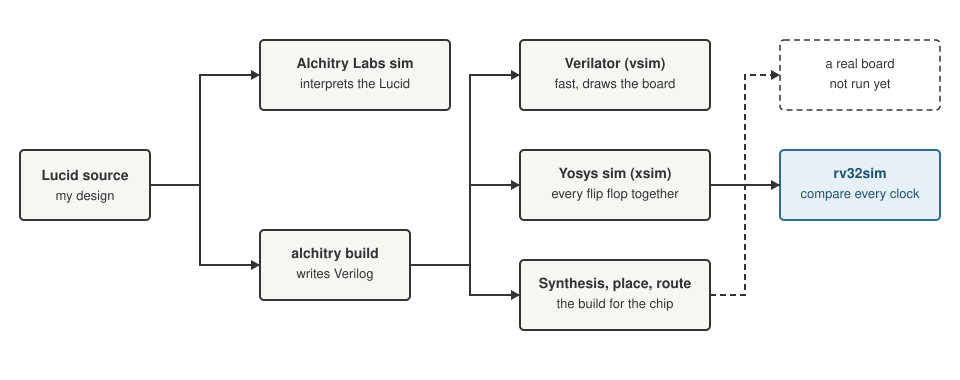

+++
date = '2026-10-18T22:00:00+11:00'
draft = false
title = 'Simulator 3: A second opinion'
description = "Using Yosys as a second simulator, independent of the Alchitry one because it reads generated Verilog, and a mutation that failed for the wrong reason."
author = 'Dean Sellers'
tags = [
    "riscv-cpu-sim",
    "simulation",
    "verification",
    "yosys",
    "fpga",
    "hardware"
]
+++

# A second opinion, and a mutation that failed for the wrong reason

*Part 3 of the simulator thread. Previously: [A simulator that lies](). The other thread is the [RISC-V soft core]() series.*

If the main simulator is a sample and not a verdict, I need a second one. Not a copy of the first, which would share its faults, but a simulator that gets things wrong in different places, or not at all.

The tools that come with Alchitry Labs have no Verilog simulator in them, but they do include Yosys, the open source synthesis tool, and Yosys has a simulator of its own.

## Where the opinions come from

The important thing is what each tool *reads*.

*The Alchitry simulator interprets my Lucid. The build turns the Lucid into Verilog, and the two other simulators run that. None of them is a real board, and the board has not run it yet.*

The Alchitry simulator works from the Lucid I wrote. The other two work from the Verilog the build writes for the chip. That makes them independent in the way that matters: if the Lucid simulator has a quirk, the Verilog ones do not share it. And if the Verilog is wrong, the Alchitry simulator, which never sees it, cannot catch that either, which is a reason to have both.

## xsim

I call the Yosys one `xsim`. It is a Python script that takes the Verilog from `alchitry build`, wraps the computer (the CPU, the RAM and the UART) in a small Verilog test harness, and runs each test program in the Yosys simulator. It does the same two things the main testbenches do:

- **For programs that run in lockstep with the model:** the control state and the program counter are checked against `rv32sim` after *every clock*, at this core's rhythm of 2, 3 or 4 clocks, and the sixteen registers at the end.
- **For programs that print:** it runs to halt, decodes the serial line itself, and compares the bytes and the registers.

The first seven programs took about eleven seconds.

Two properties make it a good second opinion. **Yosys updates every flip flop together**, so the ordering problem from the last post cannot happen. And **it runs the real RAM**, the block RAM description the chip would use, where the Alchitry simulator uses a Lucid stand in.

## What it caught that the other could not

The first run after I added the string and table programs failed. `STRING` stopped with "no stop bit", and `ILLEGAL` lost every register.

The cause was in the generated RAM initialisation. My script wrote only the non zero words of the program into the Verilog `initial` block, and in Verilog a word you leave out is **x**, unknown. The string's terminating zero, and all the memory past the end of the program, read as x. The Alchitry simulator uses the Lucid model, where an unwritten byte is simply 0, so the main testbenches passed.

The fix was to zero every word first and then write the program. And a small checker now reads the initialisation back through Yosys and rejects any x.

## Breaking the Verilog

This is the habit from part 2 of the CPU series, applied to a different place. Because xsim runs the generated Verilog, I can mutate *that*, in a scratch copy, with no rebuild:

- the RAM read address taken from the program counter, instead of the next one: all seven programs fail,
- the load strobe stuck at 0: `MEMORY`, `BYTES` and `UART` fail,
- the UART data bits shifted: wrong bytes on the wire,
- `xor` changed to `or` in the ALU: `ALU` fails, but only on the *final registers*. The state and program counter trace cannot see it.

And one that passes: the instruction register latching on every clock. xsim agrees with the hand trace that it is harmless, which confirms that the failure in the Alchitry simulator was the simulator's.

## Where it is blind

That `xor` mutation shows the weak spot. xsim checks the state and the program counter every clock, but the **registers only at the end**. The Alchitry lockstep tests check every register write.

I found a mutation that survived because of it. In the button test, a wrong judgement of the overrun bit made one handler read `0x111` instead of `0x101`. The Alchitry lockstep would have seen it. xsim did not, because a later read overwrote the register before the end.

The fix was in the test program, not the checker. The handler now ORs every value it reads into a spare register, so a stray bit survives to the end. The rule I wrote down is **tests leave their evidence in the final registers**. The same blind spot produced a false alarm too: a program that keeps writing registers forever, because its handler never stops, "failed" at the end. Every one of its 324 clocks had matched. It went on a list of programs that keep writing.

## Stretching it

Two options grew out of things the first design could not see.

- `--ce N` enables the computer on one clock in N, like the board's slow mode, and checks that the trace is the normal one stretched. That tests the clock enable plumbing and the real time timer in a simulator that updates everything together.
- `--tick-div D` builds the timer with the board's divider. Every test had used a divider of 1, and the generated Verilog had sized a width from that default. On the board's value of 25, the timer ticked every clock. [vsim found it](), and this option makes xsim guard it.

## The catch that was a coincidence

I had recorded a mutation as caught: the timer gated by the clock enable made one of the slow mode tests fail. Then xsim, at one clock in three, passed the same mutation.

That sent me back. The model gave the interrupt test identical traces at a timer rate of 1 and of 3, because the test sets the compare register to 0 and the interrupt is pending at once, whatever the rate. So that test *could not* see the mutation. The Alchitry failure had been something else: a read of the button levels that came back wrong, a sample of the ordering flake. At system level, the real time timer had no test at all.

I changed the test so the interrupt period fits the slower clock, and it now runs the timer in real time and in the old mode. The lesson was the one from part 2 of this thread: **read why a mutation run failed, not only that it did.**

## Other things Yosys does

The same tool gives two smaller checks that have nothing to do with simulation:

- **The decoder.** `check_decoder.py` evaluates the generated decoder on thousands of words, random ones and edge cases, and compares its "illegal" flag with the model's. Mutating the model's rules gives hundreds of disagreements, so the check can fail.
- **The RAM.** `check_main_ram.py` reads the initial contents back for every program and checks that the build maps 2,048 words onto sixteen block RAMs.

## When they disagree

My rule is to trust xsim and trace by hand. It is deterministic, and it runs the Verilog the build uses. An intermittent failure in the Alchitry simulator that xsim does not reproduce is rerun, not debugged.

It has a limit I should be clear about. xsim and vsim both simulate the *same Verilog*. If I have misunderstood something in how the Verilog behaves, such as the RAM collision from part 3 of the CPU series, they will both agree with me and both be wrong. And none of them is the chip. The board is the third opinion, and it has not been asked yet.

## What I learned

A second opinion is only worth having if it can disagree with the first for different reasons. Pick the tool by what it reads and how it is wrong, and then break things to see whether it can notice.

Next in this thread: [the simulator that found a bug none of these did](), a timer that ticked twenty five times too fast.
