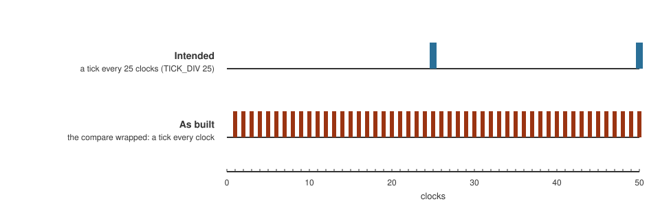

+++
date = '2026-10-19T00:25:00+11:00'
draft = false
title = 'Simulator 4: The tick that was 25 times too fast'
author = 'Dean Sellers'
tags = [
    "riscv-cpu-sim",
    "simulation",
    "verification",
    "verilator",
    "fpga",
    "hardware"
]
+++

# The tick that was 25 times too fast, and a simulator that found it by accident

*Part 4 of the simulator thread. Previously: [A second opinion](). The other thread is the [RISC-V soft core]() series.*

By the time I had two simulators I thought I had the design well covered. The Alchitry simulator ran the Lucid, and Yosys ran the Verilog, and I had checked them against a model and against each other. Then I ran a third one, for fun, and it found something neither of them could.

## Frames that did not add up

I was recording a video of the scrolling text demo, a string moving across the seven segment display one character at a time, to use in a post. The demo moves a character on a timer interrupt, and at the dial setting I used it should take about 262 milliseconds a character.

I counted frames. It was taking about 45 milliseconds. The text was scrolling roughly six times too fast.

In the simulator the timer ticks every five clocks (it is scaled so the demos feel like the board), and the symptom was six times. That looked like a tick that happened on *every* clock instead of every fifth. That was an uncomfortable thought, because on the board the divider is 25.

## The Verilog tells you

The parameters had been passed down correctly through the board, the machine, the computer and the timer, so I looked at the timer's own Verilog, the file the build generates. One line:

```text
if (D_prescale_q == sv2v_cast_11DBA(TICK_DIV - 1'h1))     // the cast is 2 bits wide
```

The prescaler counts clocks and ticks when it reaches `TICK_DIV - 1`. Lucid had generated a cast that sizes the result of that subtraction, and it had sized it from the timer's **default** value of `TICK_DIV`, which is 1, so two bits. Not from the value passed in.

With a divider of 25, `TICK_DIV - 1` is 24, which is `11000` in binary. Cut to two bits, it is `00`. The prescaler matches on every clock, and `mtime` would have run at 25 MHz instead of 1 MHz.



*Fifty clocks of the divider. A tick every 25 clocks was intended. The compare wrapped, and every clock was a tick.*

If that were on a chip, the scroll, the timer demos and the interrupt driven Larson would all have run twenty five times fast. And menu 3's delay loop, which calibrates itself from a read of the divider, would have disagreed with menus 4 and 5 by the same factor. I have not run this design on a board, so this is what the design *as built* would have done.

## Why nothing else saw it

This is the part worth the post.

- **The Alchitry simulator** evaluates Lucid's arithmetic properly. In *its* world `25 - 1` is 24. It never sees the cast.
- **The timer's own testbench** runs in that simulator, so it passed too.
- **Every test of the CPU** used a divider of 1, and so did the Yosys cross check. At a divider of 1, `TICK_DIV - 1` is 0, and 0 in two bits is still 0. The wrong width cannot show.
- **Yosys** said nothing. An earlier bug of the same family, the display counter that wrapped to zero, had at least produced an out of range warning. This one produced none.

It is the same trap I found a day earlier, a parameter sized at the wrong width in the generated Verilog, and a nastier relative of it. That time the *value* wrapped. This time it was the *default* that set the width, not the number I passed.

Only the third simulator, run for fun with a divider other than 1, was ever going to see it. (It uses 5, a scaled down 25, so the demos feel like the board.) Every test I had written exercised only the value that hides it. That is the point I want to make: **the tests were green because they asked only the questions the bug could not answer.**

## The fix

Do not do arithmetic on a parameter inside an expression. The prescaler now compares `prescale.q + 1 == TICK_DIV`, where the width comes from the prescaler's own register, and the cast is nine bits. I scanned every cast in the generated Verilog that involved a parameter, and the others were safe: the display scanners, the debouncer and the reset conditioner have defaults wide enough, and the machine's `FAST_BITS - 1` really is 1 minus 1.

## A regression test that can fail

A fix is only worth something with a test, and the test has to be able to see the thing:

- **`xsim --tick-div D`** builds the timer with the divider D in the Yosys harness, so the prescaler is exercised with something other than 1.
- **The model** learned the prescaler: `mtime` at a given clock is the base plus the clock count divided by D, with a write setting the base.
- **Mutation:** I put the old two bit compare back into a copy of the timer. The test failed at a divider of 5 and *passed* at 1, which is exactly how the bug hid.

And a detail I like: a divider of 3 would not have caught it. `3 - 1` is 2, and 2 fits in two bits. The value has to be one that wraps, so 5 is the check.

## What this says about the three of them

| | Reads | Divider | Saw it? |
|---|---|---|---|
| Alchitry simulator | the Lucid | does the sum correctly | no |
| Yosys (xsim) | the Verilog | tests used 1 | no |
| Verilator (vsim) | the Verilog | 5, scaled from the board's 25 | **yes** |

It is not that vsim is better. It is that it was run with different parameters. The lesson I take from the whole simulator thread is that agreement between two tools only matters if they have been asked different questions.

## What I learned

A bug that depends on a parameter value only appears when a test uses that value. Run the configuration you actually mean to build, or one close to it, at least once, in at least one tool. And a tool built to *watch*, like vsim, will sometimes see more than a tool built to *check*, because a person is looking at the frames.

That is the end of the simulator thread for now. The machine posts carry on with what the core does when it has nothing to do.
