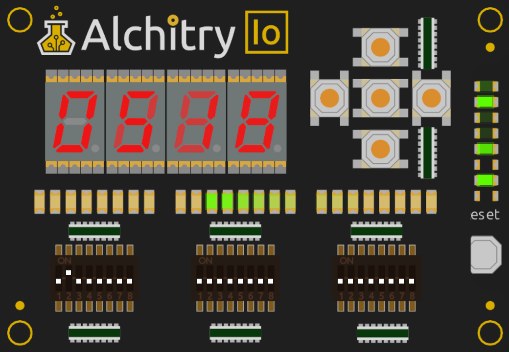
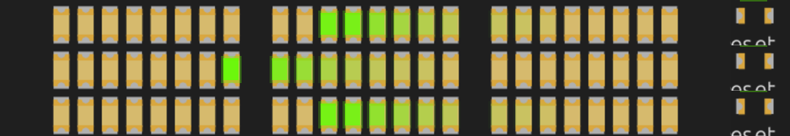

+++
date = '2026-11-09T09:00:00+11:00'
title = 'Zephyr 10: Larson, from the main thread'
description = "The fading Larson scanner that began this series, run from Zephyr's main thread with the hardware PWM and sigma-delta channels doing the dimming. It fits, with 164 bytes to spare, and it runs on the board."
author = 'Dean Sellers'
tags = [
    "zephyr",
    "riscv-cpu",
    "riscv",
    "fpga",
    "rtos",
    "embedded",
    "leds"
]
+++



# Larson, from the main thread

*Part 10 of the Zephyr series. Previously: [The upgrade that grew 516 bytes]()*

The first program this core ran was a Larson scanner, a light that sweeps back and forth, the way the front of a certain talking car does. It is where the main series started and where [part 12]() came back to it. So it is the obvious way to end this one: put the same scanner on top of Zephyr.

The question for this part: **can Zephyr's main thread run the scanner, with the hardware doing the dimming, in what is left of the memory?**

## What the hardware already does

The Io board has 24 LEDs. Between them and the CPU sits a peripheral I built for the C version, the LED dimmer bank: 24 brightness bytes, one per LED, and hardware that turns each byte into a one-bit output, continuously, with no help from the CPU. It has two modes. In PWM, a counter runs and the LED is on while the count is below the brightness. In sigma-delta, an accumulator adds the brightness every tick and emits a pulse when it overflows, so the LED gets a pulse *density* and not a pulse *width*. Both give exactly `brightness` ones in every 255 ticks, so they look identical to the eye and different on a scope.

The CPU's whole job is to say how bright each LED should be, often enough to look smooth. That is a small job, and it is a good fit for a thread that sleeps.

## The thread

Each frame the main thread does four things: it makes every LED keep seven-eighths of its brightness (the afterglow, like the bulbs on the original), moves the head every third frame, converts the 24 levels through a gamma table, and writes six words to the dimmer bank. Then it sleeps.

```c
for (;;) {
	sys_write32(1 | (LED_PRESCALE << 1) | (((sys_read32(SWITCHES) >> 4) & 1) << 4), LEDS_CTRL);

	for (int i = 0; i < NLEDS; i++) {
		level[i] -= level[i] >> DECAY_SHIFT;
	}
	if (++phase >= STEP_FRAMES) {
		phase = 0;
		level[pos] = 255;
		pos += dir;
		if (pos == 0 || pos == NLEDS - 1) {
			dir = -dir;
		}
	}
	for (int w = 0; w < NLEDS / 4; w++) {
		const uint8_t *l = &level[4 * w];

		sys_write32((uint32_t)gamma_lut[l[0]] | (uint32_t)gamma_lut[l[1]] << 8 |
			    (uint32_t)gamma_lut[l[2]] << 16 | (uint32_t)gamma_lut[l[3]] << 24,
			    LEDS + 4 * w);
	}
	k_msleep(FRAME_MS - 1);
}
```

The first line is the mode switch. Bit 4 of the middle DIP bank picks PWM or sigma-delta and is read every frame, so you can flip it while the scanner runs.

Two things in there are from earlier in the series.

**The `- 1`.** [Part 6]() found that a relative sleep wakes one tick late. A frame is meant to be 10 ms, so the thread asks for 9 and gets 10.

**The gamma table.** The dimmer's brightness is linear but the eye is not, so levels go through a 256-entry table. The table is the one the C fader already used, `c/gamma.h`, generated once by a script. The sample's build adds that directory to its include path and uses the file as it is. There is one copy of the table in the whole repository, and the project's rule about addresses ([Part 1]()) turns out to cover tables too.

The addresses of the switches and the dimmer come from the device tree, `DT_REG_ADDR(DT_NODELABEL(leds))`, so there is no address in the C file.

## Does it fit?

This was the part I was unsure about. The ROM half has 10,240 bytes, and the tick image already used 9,632, leaving 608.

| | tick | Larson |
|---|---|---|
| ROM | 9,632 B | 10,076 B |
| RAM part | 1,376 B | 1,392 B |
| ROM headroom | 608 B | 164 B |

It fits, with 164 bytes of ROM to spare. The growth is 444 bytes, and most of it is easy to account for: `main` is 292 bytes against the tick sample's 92, and the gamma table is 256. The RAM half barely moved.

I should say what that means in context. The [last part]() found that Zephyr 4.5.0 would add about 516 bytes. If it grew by the same amount, Larson on 4.5.0 would no longer link: it would be about 350 bytes over. The way out is the switch from that part, `CONFIG_EXCEPTION_DUMP`, or a bigger ROM half. It is a good example of why I wanted the size ceiling to fail at the link.

## Checking it

Three kinds of simulation first, then the board.

- **The instruction-level simulator** runs the image and records the dimmer's brightness bytes. The greeting prints, the control register becomes 0x07 (enable, prescale 3, PWM) or 0x17 with the mode bit, the head lights LED 0 at 255 and moves to LED 1 three frames later, and the tail is a gamma-corrected decay. At one point the levels rise `1 1 3 7 15 35 81` up to the head at 255.
- **The Verilog simulator** runs the real design for the first 13,000 instructions, in both modes, against the same model, and prints the 38-byte greeting both times. That checks the program counter and the state on every clock. It does not look at the LEDs.
- **The interactive simulator** draws the board. At 0.40 s of board time the head is lit in the middle bank with a tail fading away behind it. At 0.50 s it has moved on to the far end of the neighbouring bank. With the mode bit set, sigma-delta, the frame at 0.40 s looks the same as the PWM one. That is the thing the dimmer promises, and it is nice to see.



The same three frames, cropped to the LED strip: PWM at 0.40 s, PWM at 0.50 s, and sigma-delta at 0.40 s.



## On the board

I flashed it. The scanner swept back and forth with the fading tail, the 10 ms frame looked smooth, and the PWM and sigma-delta modes looked the same when I flipped the switch between them. I pressed the Cu reset a few times and it restarted each time without trouble. Nothing went wrong.

I then repeated the resets with a serial capture open, as the only reader on the port. Eight presses, at gaps from 0.3 s up to nearly a minute, gave eight greetings, `larson up on alchitry_cu_io/riscitry`, each exactly right. There was no other output. That matters here, because Zephyr prints a fault dump on the serial port when it crashes, and the crash in [Part 8]() looked exactly like that. The thread spends nearly all its time asleep, so these resets landed in the same state that killed the old image, and none of them did.

That is what I saw with my eyes, and that is as far as it goes. I did not scope the LED pins, so what the two modes do to the waveform is the dimmer's own testbench's claim and not something I measured here. I did not run a long soak, as I did for the ticks in [Part 6](). Eight resets is a handful, and I did not scan reset moments in simulation as I did for the tick image, so this is a sample and not a proof.

## What this does and does not show

It shows that a stock kernel's main thread and one shared table are enough to do what a hand-written interrupt handler did in [part 12](), and that the hardware dimmer makes it cheap. There is no interrupt handler here, no counter, no `WFI` in my code. The kernel sleeps the CPU between frames, because that is what a sleeping thread means. And it runs on the board.

The scanner that started the main series now runs on someone else's operating system, from a thread that sleeps. That is where I wanted this to end.

If you haven't read how this soft core was built up, there is a [series of posts on that]() too. Next up, I am working on some hardware that reverses the DAC used here, to make an ADC.
